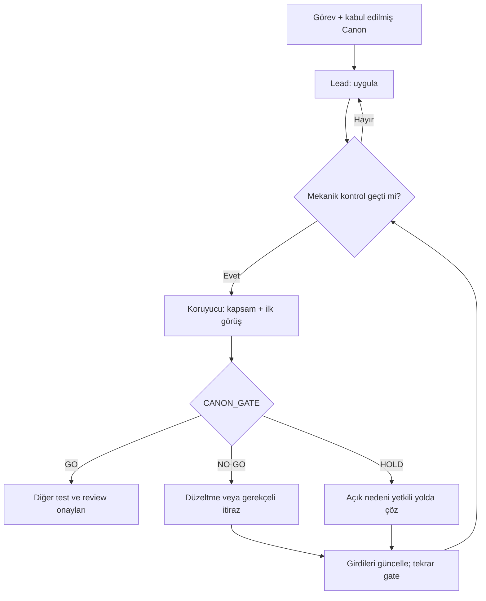
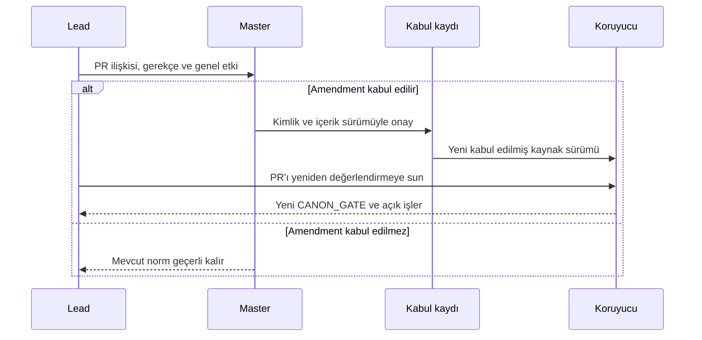
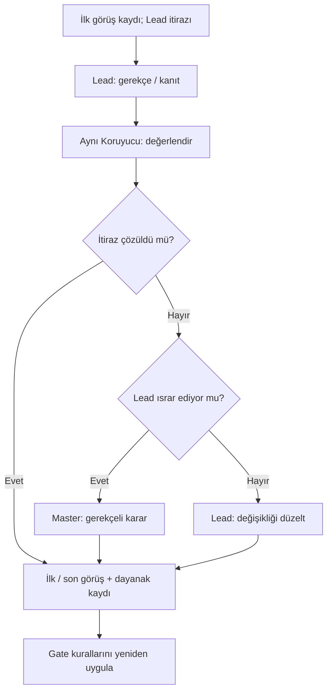
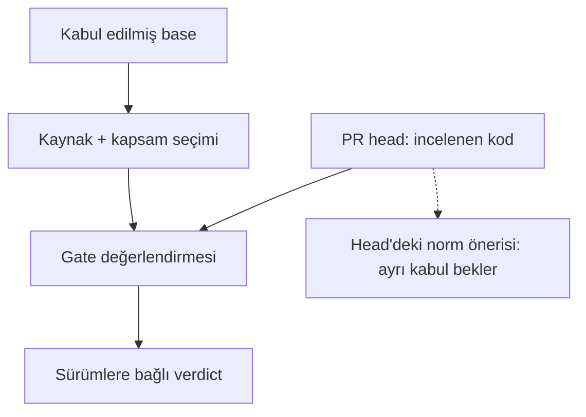
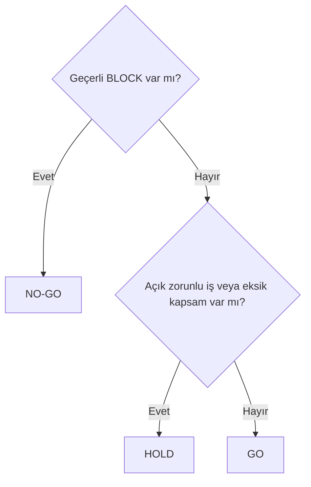
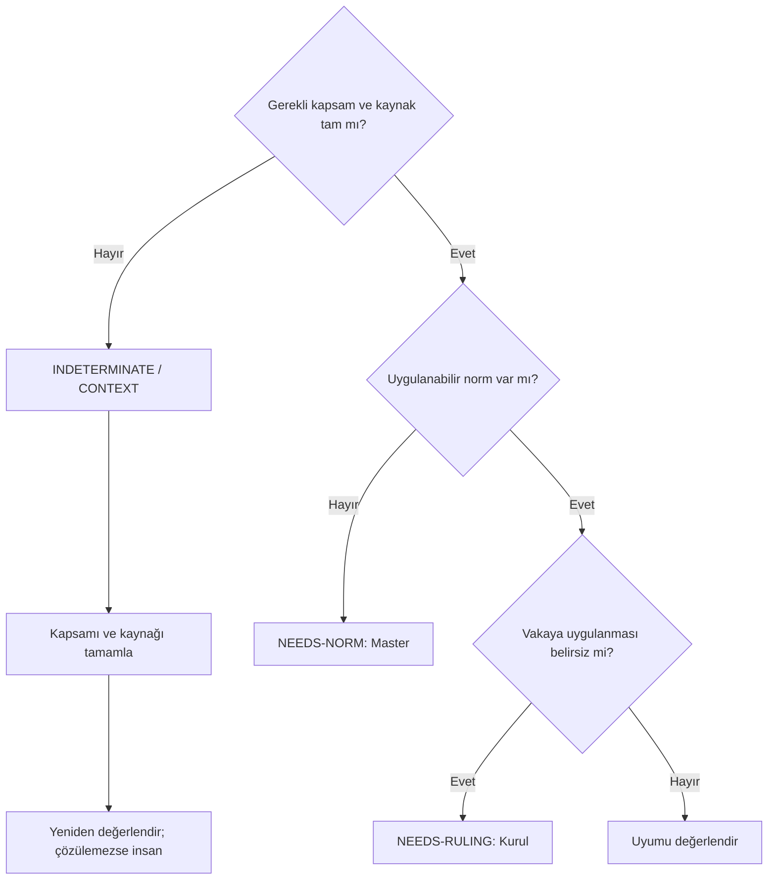

# Canon-Driven Development

### Agentic yazılım geliştirmede kimliğin korunması için bir insan–ajan yönetişim önerisi

*v0.3 — kapsam, insan yükü ve görsel akışlarla gözden geçirilmiş öneri*

> Kod ucuzladıkça asıl problem kod yazmak olmaktan çıkar; sistemin binlerce küçük değişiklik boyunca **aynı şey olarak kalması** olur.

---

## 0. Tek paragraf

CDD, bir yazılım sisteminin **kimliğini** — ne olduğu, ne olmadığı, nasıl davrandığı — kodun dışında, kısa ve verbatim bir metinde tutar: **Canon**. Canon'dan türeyen **Alt Kitaplar** ve tek tek vakalarda verilmiş **Ruling**'ler ikinci ve üçüncü katmanı oluşturur. Dört rol vardır: kodu üreten **Lead** ajan, canon'a tek sadakati olan ve yalnızca veto yetkisi taşıyan **Koruyucu** ajan, süreci denetleyip yalnızca rapor yazan **Müfettiş** ajan, ve Canon'un sahibi ve koyucusu olan insan **Master** — Canon'un ne anlama geldiği ve ne zaman değişeceği üzerindeki nihai otorite. Lead inşa eder, Koruyucu korur, Müfettiş denetler; hiçbiri Master'ın yerine Canon yaratamaz. Önerinin çekirdeği canon dosyası değil, yetkilerin ayrılmasıdır: **builder kendi hakemi olamaz.**


### 0.1 Okuma ve başlangıç yolu

İlk okumada bu bölüm, §4'teki yetki haritası ve §9.1'deki günlük döngü yeterlidir. Bir kararın sınırını ararken §6'ya, kurulumu büyütürken §10'a dönülür. Diyagramlar bu yolları gösterir; ayrıntılı kurallar ilgili bölümlerde kalır. Tarihsel örnekler Ek A'dadır.

| Rol | Günlük işi | Yetkisinin sınırı |
|---|---|---|
| **Master — insan** | Ürünün kimliğini koyar; yeni norm ve çözülemeyen anlaşmazlıkta karar verir | Kararı kayda ve kabul edilen sürüme bağlar; doğru karar vereceği garanti edilmez |
| **Lead — ajan** | Tasarlar, uygular; gerekçesini ve kanıtını sunar | Kendi uygulamasının nihai canon hakemi olamaz |
| **Koruyucu — ajan** | Canon'a karşı değerlendirir; aynı rol ve ilgili geçmişle diyaloğu sürdürür | İtiraz edebilir; yeni norm koyamaz, implementasyon dayatamaz |
| **Müfettiş — ajan** | İşleyişi ve yetki kullanımını örnekleyerek denetler | Rapor üretir; veto veya norm koyma yetkisi yoktur |

**Şekil 1 — Günlük geliştirme döngüsü.** CONSULT, inşa sırasında gerektiğinde açılır. Gate'teki NO-GO ve HOLD farklı çözüm yollarına gider; GO, kalan test ve review onaylarını kaldırmaz.



**Faz 0'ın somut başlangıcı:** `CANON.md`, `GUARDIAN.md`, `RULINGS.md` ve gate'i başlatan bir komut veya çalışma talimatı. Önce ürünün sahibi kısa canon'u kabul eder; sonra Lead uygulamayı üretir, ayrı değerlendirme rolündeki Koruyucu ilk görüşünü kaydeder. Bir itiraz varsa aynı Koruyucu'yla gerekçeli diyalog açılır. Kod, normatif kaynak veya değerlendirme kapsamı değişirse ilgili inceleme yenilenir.

Başlangıç şablonları ve ilk örnek çalışma [kurulum rehberindedir](docs/getting-started.tr.md). Şablon üretmek onay vermek değildir; örnek ürünün ilkeleri başka bir ürün için kendiliğinden geçerli olmaz.

**Kısa sözlük:** *ruling*, vakaya ilişkin yorum kararı; *isnad*, türetme zinciri; *nesih*, yürürlükten kaldırma; *apokrif*, normatif olmayan belge; *corpus*, değerlendirmede kullanılan kaynak bütünü; *amendment*, norm değişikliği; *Ledger*, takip ve sapma kaydıdır. `Master` bu metinde insan rolüdür; örnek üründeki `role=master` ise ürünün kendi yetki değeridir.

---

## 1. Bağlam ve öneri

Bu öneri yeni bir şey keşfettiğini iddia etmiyor; birkaç mevcut fikrin üzerine bir yetki topolojisi kuruyor.

**Üzerine inşa ettiklerimiz:**

- *Architectural fitness functions* — mimariyi CI'da assert edilebilir kurallara indirme fikri.
- *ADR'ler* — kararların gerekçesiyle birlikte kaydedilmesi.
- *DDD ubiquitous language* — sistemin kendi kavramlarıyla çelişmemesi.
- *Spec-Kit constitution* — projeyi yöneten ilkelerin ayrı bir dosyada tutulup spec/plan/implement aşamalarında compliance kontrolü yapılması.
- *Constitutional Spec-Driven Development* (Marri, 2026) — non-negotiable ilkelerin spec katmanına gömülmesi; güvenlik odaklı.
- *Specification Governance Reference Model* (Alenezi, 2026) — stokastik generator'ın deterministik bir validation boundary içine yerleştirilmesi.

Bunların ortak deseni tek bir boru hattıdır: `constitution → generation → compliance`. Compliance'ı çoğunlukla ya mekanik kurallar ya da üreten ajanın kendisi yapar.

**Hedeflediğimiz boşluk** iki tane:

1. Fitness function'lar mekanik olmak zorundaydı. "Bu ekran kullanıcıyı yanlış mental modele götürüyor mu?" sorusu makineleşemiyordu. LLM'ler **semantik fitness function**'ı ucuzlattı; ama bunu üreten ajana sorarsan builder bias'ı cevabı belirler.
2. Constitution'ı *kimin yorumladığı* çoğu yaklaşımda tanımsız. Yorum yetkisi tanımsızsa ya builder kendine hakemlik eder ya da her yorum insana döner.

**Önerdiğimiz şey:** canon'u yorumlama, uygulama ve denetleme yetkilerini ayrı ajanlara vermek; yorum otoritesinin sahibini insan olarak sabitlemek; ve bu yetkilerin hangi durumda kime geçtiğini açık bir haritayla belirlemek.

Korunan invariant tek cümle: **hiçbir ajan hem normu yaratıp, hem uygulayıp, hem kendi uygulamasını onaylayamaz.** "Builder kendi hakemi olamaz" bunun en sık karşılaşılan hali; Koruyucu'nun norm üretememesi ve Müfettiş'in yetkisiz olması aynı invariant'ın diğer yüzleri.

---

## 2. Üç katman

| Katman | Kapsam | Context'e alınması | Değişim |
|---|---|---|---|
| **Canon** | Ürünün kimliği ve yetki çekirdeği | Her değerlendirmede verbatim | Master'ın açık kabulüyle |
| **Alt kitaplar** | Domain kuralları ve türetme zincirleri | İlgili kapsamda verbatim | DERIVED için Kurul; NEW NORM için Master |
| **ACTIVE ruling'ler** | Vakaya uygulanacak yorum | İlgili kapsamda | Kurul yorumu; Master geri çekebilir |

Otorite yukarıdan aşağı akar: **canon > alt kitap > ruling, her zaman.** Alt bir katman üst katmanı ne özel olduğu için ne yeni olduğu için ezemez. Terfi aşağıdan yukarı: tekrar eden ruling'ler alt kitaba, nadiren alt kitap maddeleri canon'a yükselir.

### 2.1 Canon

Canon, ürünün kimliğidir: ne olduğu, ne olmadığı, kullanıcıya nasıl davrandığı, hangi trade-off'ta hangi tarafı seçtiği ve asla yapmayacakları. Kimlik çekirdeği bir sayfayı hedefleyen, numaralı maddelerden oluşan, ürünün sahibi tarafından yazılmış bir metindir. Feature listelemez; feature'ları sınırlar. "Yetki yalnız sunucu tarafında belirlenir" ya da "günlük kullanıcı yüzeyi ile yönetici yüzeyi ayrıdır" gibi cümleler canon'dur — bir developer bunları ihlal eden temiz, test edilmiş, çalışan kod yazabilir ve ürün yine de kendisi olmaktan çıkar. Canon tam olarak bunu yakalamak için vardır: testlerin göremediği "hâlâ aynı ürün mü?" sorusunun cevabı. Her ajanın context'ine olduğu gibi girer ve nadiren değişir.

Canon bir SPEC değil; ürünün anayasasıdır. İçeriği:

- Ürün nedir / ne değildir
- Değişmez ilkeler — kısa, numaralı (`C-01`, `C-02` …)
- Trade-off'larda hangi taraf seçilir
- Asla yapılmayacaklar
- **Yorum ve değişiklik yetkisinin kimde olduğu** (§4)
- **Alt kitap haritası**: hangi domain'e dokununca hangi kitap yüklenir
- **Apokrif listesi**: canon sanılması muhtemel olduğu için ayrıca işaretlenen belgeler. Normatiflik allow-list'tir: yalnız alt kitap haritasında listelenen dosyalar normatiftir; listede olmayan her şey varsayılan olarak apokriftir

Canon kuralları:

1. **Üründen kopuk yazılmaz.** Asıl hali çekirdekten büyütülen bir `principles.md`'dir: ilke yazılır, ona göre inşa edilir. Olgun bir codebase için fallback, canon'u mevcut üründen çıkarmaktır — hayalden yazmak değil; aksi halde kod ve canon iki ayrı gerçek kaynağına dönüşür. Repo'daki diğer belgeler canon değildir ve apokrif olarak işaretlenir.
2. **İlke lifecycle'ı:** `DRAFT → Master onayı → CANON → implemented/verified`. Bir ilkenin kodda uygulanması onun *uygulandığının* kanıtıdır, *doğru olduğunun* değil. Normatif adım Master'ın onayıdır; tek kişilik projede bu, ilkeyi yazmakla aynı andır — ama Lead'in teklif ettiği bir ilke için ayrı bir adımdır.
3. **Verbatim girer, özetlenmez.** Hiçbir ajan canon'u kendi özetiyle context'ine almaz. Her paraphrase bir kopist hatasıdır.
4. **Canon içi çelişki otomatik çözülmez.** İki madde çelişiyorsa gate kapanır; explicit amendment gerekir. "Geç madde erkeni ezer" kuralı canon içinde **yoktur** — olsaydı dosya sırası anayasal değişiklik mekanizmasına dönüşürdü.
5. **Değişiklik iz bırakır.** Amendment metadata taşır:
   ```
   C-17
     supersedes  : C-04
     ratified_by : Master
     date        : 2026-09-02
   C-04  [SUPERSEDED BY C-17]
   ```
   Eski madde görünür kalır.
6. **Kısa kalır.** Bir sayfa hedefi kimlik çekirdeği içindir. Yetki maddesi, alt kitap haritası ve apokrif listesi usul ekinde tutulabilir; bağlayıcı yetki maddeleri de verbatim yüklenir. Domain detayı alt kitaba iner.

Örnek — bu dokümandaki bütün örnekler aynı hayali üründen: üyelerin tek bir yönetici altında çalıştığı, günlük kullanım yüzeyi (**Everyday**), talep üzerine açılan yüzey (**On-Demand**) ve yönetim yüzeyi (**Operator**) birbirinden ayrı tutulan bir koordinasyon uygulaması:

> **C-04** — Authority isimden veya client payload'dan türetilemez; yalnızca server-derived'dır.
>
> **C-09** — Everyday, On-Demand ve Operator birbirinden farklı interaction surface'leridir; tek generic dashboard altında birleştirilemez.

### 2.2 Alt Kitaplar

Alt kitaplar, canon'daki bir ilkenin belirli bir domain'de ne anlama geldiğini açan, daha uzun ve daha somut metinlerdir. Canon "authority server-derived'dır" der; auth alt kitabı bunun legacy uyumluluk path'lerinde, token yenilemede, admin bootstrap'inde tek tek ne demek olduğunu yazar. Hâlâ "ne / ne değil" konuşurlar, "nasıl" konuşmazlar: implementasyon seçmezler, sınır çizerler. Domain bazlı bölünürler çünkü canon her context'e girer, alt kitaplar yalnız ilgili domain'e dokunulduğunda yüklenir. Her maddesinin kaynağı bellidir: ya hangi canon ilkesinden türediği (DERIVED) ya da Master'ın onayıyla ve hangi ilkelerle tutarlı olarak girdiği (NEW NORM). Kaynağı gösterilemeyen madde ya oraya ait değildir ya da canon'da eksik vardır. Kurul yazar, yeni normu Master onaylar; canon'un altında dururlar.

Domain bazlı (`auth`, `surfaces`, `data-model` …). Her madde bir **isnad** — türetme zinciri — taşır. Ve her madde iki türden biridir:

```
S-AUTH-12
  tür        : DERIVED
  canon      : C-04
  doğuran    : R-031 (stale client role=master vakası)
  tarih      : 2026-08-14
  madde      : Legacy compatibility path'leri client-originated role hint'i kabul etmez.
```

```
S-SURF-21
  tür              : NEW NORM
  source           : MD-014 (Master kararı)
  ratified_by      : Master
  consistent_with  : C-09
  tarih            : 2026-08-30
  madde            : On-Demand surface'te oturum 30 dakika hareketsizlikten sonra kapanır.
```

| Tür | Tanım | Kim doğrular | Kim onaylar |
|---|---|---|---|
| **DERIVED** | Mevcut bir canon maddesinin operasyonel açılımı; canon'dan cite ile türetilebilir | Koruyucu | Kurul |
| **NEW NORM** | Canon'un söylemediği yeni bir davranış getiriyor | Koruyucu "yeni norm" der | **Master** |

Bu ayrım olmadan alt kitap bir privilege-escalation yoludur: Lead + Koruyucu, canon'un söylemediği bağlayıcı kurallar üretebilir. Ayrımı Koruyucu yapar ve Lead'in "yeni normu türetilmiş gibi yazmayı" öğrenmesi gerçek bir risk olduğu için Müfettiş DERIVED sınıflandırmalarını örnekler. Her maddenin provenance'ı vardır, ama her maddenin canon'dan türetmesi olmak zorunda değildir: NEW NORM'un meşruiyeti türetme değil, Master'ın açık onayıdır — yine de canon'la çelişemez, `consistent_with` bunu cite eder.

İsnad'ın mekanik kontrolü CI'dadır: referans verilen madde var mı, SUPERSEDED değil mi, alıntılanan metin canon'daki metinle birebir aynı mı. NEW NORM için: `ratified_by` ve `consistent_with` alanları var mı; onay kaydı, yetkili Master kimliği ve onaylanan içerik sürümüyle eşleşiyor mu. `ratified_by` tek başına bir onay değildir. Bu kontrol türetmeyi doğrulamaz — kör yeniden türetme de buna ilişkin bir denetim sinyalidir (§3.4) — ama uydurma ID'yi ve neshedilmiş maddeye dayanmayı anında yakalar. Vektör benzerliği hiçbirinin yerine geçmez.

Alt kitaplar arası öncelik kuralları baştan yazılır:

- **lex superior** — üst kaynak kazanır; koşulsuz
- **lex specialis** — özel kural genel kuralı ezer; **yalnızca aynı otorite seviyesinde** (alt kitap vs alt kitap, ruling vs ruling)
- **lex posterior** — aynı seviyede yeni eskiyi ezer; canon içinde geçersiz

İsnad iki iş görür: türetmenin doğrulanamadığı madde, olası norm boşluğunu veya sınıflandırma sorununu görünür kılar (**boşluk tespiti**); doğuran kaygı ortadan kalktığında madde emekliye ayrılır (**budama**). Doğrulanamama tek başına boşluk kanıtı değildir (§3.4). Alt kitapların canon'dan yüz kat büyük olması sorun değil; isnadsız büyümesi sorundur.

### 2.3 Rulings

Ruling, ilgili bir normun var olduğu ama vakaya nasıl uygulanacağının belirsiz olduğu bir durumda verilmiş tek bir yorum kararının kaydıdır. Lead bir şey yapmak ister, "bu C-09'a uyar mı?" diye sorar; madde vardır ama bu vakayı açıkça kapsamamaktadır; birinin yorumlaması gerekir. O yorum, gerekçesiyle birlikte `RULINGS.md`'ye bir satır olarak yazılır ki aynı soru bir daha sıfırdan yorumlanmasın. Ruling yeni kural koymaz; var olan maddenin bu vakada ne dediğini söyler. Uygulanabilir hiçbir madde yoksa bu ruling'in işi değildir — boşluktur ve Master'a gider. Aynı türden ruling'ler birikince artık tek vaka değil kural demektir ve alt kitaba çıkar; koşulları değişince eskir. En hafif, en hızlı, en geçici katmandır.

Ruling bir **Kurul kararıdır**:

1. Lead sorar; Koruyucu "belirsiz" der, belirsiz olan maddeyi cite eder ve durur.
2. Lead bir yorum teklif eder.
3. Koruyucu teklifi cite edilen maddeye karşı kontrol eder: maddenin bir okuması mı, yoksa maddenin söylemediği bir şey mi.
4. Okumaysa ve uzlaşılırsa → ruling, `RULINGS.md`'ye girer. Master'a gitmez; Master log'u görür ve **geri çekme hakkı** vardır.
5. Koruyucu hayır der ve Lead ısrar ederse → Master.
6. Master kararı çıkana kadar → statüko; belirsizliğe bağlı değişiklik HOLD kalır.

Koruyucu "boşluk" derse — hiçbir madde uygulanmıyorsa — ruling yoktur. Kurul yorumlayacak bir şey bulamaz ve norm yaratamaz. Vaka NEEDS-NORM olarak Master'a gider; Master ya alt kitaba NEW NORM olarak ekler ya da kimlik seviyesindeyse canon amendment açar. Üçlü şudur: **Koruyucu yorumlar, norm üretmez. Kurul yorumlar, norm üretmez. Yalnız Master norm koyar.**

Belirsiz ile boşluğu ayıran şey cite'tır: belirsizlik iddiası ilgili bir madde numarası taşımak zorundadır. Gerekli corpus tam yüklüyken uygulanabilir madde bulunamıyorsa boşluktur; corpus eksikse INDETERMINATE'tir (§6). Bu, Koruyucu'nun boşluğu belirsizlik gibi sunup vakayı Master yerine Kurul'a yönlendirmesini engeller; Müfettiş NEEDS-RULING'leri örnekler.

Bunun adı **delegated interpretive authority**: Master yorum otoritesinin sahibidir; rutin yorum yetkisini Kurul'a devreder ve her ruling üzerinde geri çekme/nesih yetkisini korur. Master nihai otorite, Kurul birinci derece yorumcudur. Devir örtük değildir — canon'un yetki maddesinde yazılıdır ve amendment'la daraltılabilir. Böylece yorum hafif ve hızlı kalır, otorite yine insanda kalır.

Her ruling bir lifecycle taşır:

| Durum | Anlamı | Gate'te kaynak mı? |
|---|---|---|
| ACTIVE | Uygulanabilir yorum yürürlükte | Evet |
| PROMOTED | Yetkili kabul ile alt kitaba taşındı | Yeni kaynak kullanılır |
| SUPERSEDED | Yeni ruling veya madde yerini aldı | Hayır |
| EXPIRED | Uygulanma koşulları ortadan kalktı | Hayır |
| ARCHIVED | Tekil kaldı; kayıt için tutuluyor | Hayır |

Yalnız ACTIVE ruling'ler normatiftir. Aktif bir ruling geçici otoritedir, sonsuza dek donmuş içtihat değil. Lifecycle geçişleri tek tek bürokrasi olmasın diye AUDIT loop'u PROMOTE/EXPIRE adaylarını toplu önerir, Kurul toplu onaylar. Log, "buna daha önce böyle karar verilmişti" makinesine dönüşmemeli — içtihat kapısı kapanırsa sistem donar.

### 2.4 Ne ve nasıl — normatif olan ve olmayan

Üç katmanın tamamı **normatif**tir: ürünün ne olduğunu ve ne olmadığını söyler. **Nasıl** yapılacağını söylemez. "Nasıl" Lead'in işidir; alt kitapta implementasyon ayrıntısı yoksa bu "sessiz" değil, **serbestlik**tir. Her implementasyon detayı için ruling istenirse sistem kilitlenir.

Lead'in uygulayacağı tek test:

> **Bu soruya verilecek cevap ürünün ne olduğunu değiştirir mi?**

```
"Authority'yi hangi middleware'de derive edelim?"            → hayır → Lead karar verir
"Bulk assignment queue ile mi, transaction ile mi?"           → hayır → Lead karar verir
"Operator'a member listesi gösterelim mi?"                    → evet  → CONSULT (C-09)
"Bulk role assignment olsun mu?"                              → evet  → CONSULT
```

Normatif madde implementasyon **uzayını daraltır**, tek bir implementasyon seçmez. "Client-originated role hint hiçbir authority decision path'ine ulaşamaz" normdur; "middleware X kullan" değildir. Compliance condition'ın yalnız hedef durumu söylemesi de bu yüzdendir: yöntem bilinçli olarak Lead'e bırakılır.

"Nasıl"ın yaşadığı yer dördüncü, **normatif olmayan** katmandır:

```
CANON > ALT KİTAP > ACTIVE RULING     normatif — ne / ne değil

TEKNİK DOKÜMANLAR                     normatif değil — nasıl
  ADR'ler, design doc'lar, kod        Lead'in malı; canon açısından apokrif
                                      Koruyucu bağlam için okur, norm olarak cite etmez
```

İki failure mode:

- **Aşırı danışma** — Lead her detayı CONSULT'a taşır, NEEDS-RULING seli olur. Ucuzdur, kendini gösterir.
- **Eksik danışma** — normatif bir karar "teknik tercih" kılığında geçer, kimse sormaz. Tehlikeli olan budur. Breaker pass ve audit yakalar; Müfettiş, Lead'in "operasyonel" diye kendi verdiği kararları örnekler.

Ters yönde de bir drift vardır: alt kitap "nasıl" yazmaya başlarsa spec'e dönüşür. Alt kitap maddesi bir implementasyon seçiyorsa Koruyucu bunu isnad kontrolünde işaretler — canon'dan norm türer, yöntem türemez.

---

## 3. Roller

### 3.1 Master — insan

CDD, ajanların normu yetkisiz değiştirmesini sınırlar. Master'ın yetkili değişikliklerini görünür kılar; Master'ın doğru karar vereceğini garanti etmez.

Canon'un sahibi ve koyucusu. Canon'un ne anlama geldiği ve ne zaman değişeceği üzerindeki nihai otorite. Her PR'ı okumaz; **kimlik kararlarını** verir. Devreye girdiği yerler: canon-tier değişiklik (Kurul uzlaşsa bile), NEW NORM onayı, veto itirazı, Kurul'da beraberlik, audit ve teftiş sonuçları.

Buradaki "Master" teknik anlamda master node/branch değil; canon üzerinde **kurucu iktidara** sahip kişi. Hukuktaki ayrım birebir uyar: Master *kurucu iktidar*dır — canon'u ilk kez koyar ve amendment'ı ratify eder. Lead, Koruyucu ve Müfettiş *kurulmuş iktidar*lardır — canon'un verdiği yetkilerle çalışırlar ve hiçbiri Master'ın yerine canon yaratamaz.

Yetkilerin işlem bazında dağılımı §4'tedir; günlük rol dağılımı §0.1'de özetlenir.

**Master Canon'un üstündedir; ajanlar değildir.** Uygulama notu: bazı projelerde "master" aynı zamanda bir domain terimidir (örnek üründeki single-master invariant gibi); agent-facing dosyalarda rol adı ile domain terimi açıkça ayrışmalıdır.

**Master Koruyucu'yu override edebilir; Canon'u ancak değiştirerek aşar.** Bu, önerinin en önemli cümlelerinden biridir ve iki durumu kesin ayırır:

```
Koruyucu yanlış yorumladıysa
  → Master verdict'i override eder, gerekçesi karar kaydına girer, canon değişmez.
  → Tekrar kullanılacak norm yorumu varsa ayrıca RULINGS'e girer.
  → Doğrulanmış yanlış blok precision hesabına, override kaydı Müfettiş'in örneklemesine girer.

Koruyucu doğru yorumladıysa ve değişiklik canon'u gerçekten ihlal ediyorsa
  → Master ruling ile merge edemez.
  → Ya implementasyon değişir, ya Master canon'u açık bir egemenlik işlemiyle değiştirir.
```

Somut olarak:

```
Koruyucu:  C-04 ihlali → NO-GO

Master:
  "merge et"                                          ✗  sessiz override; canon delinir
  "C-04'ü değiştiriyorum, amendment aç"               ✓  egemenlik işlemi; canon değişir
  "C-04 için bu vakaya istisna, canon'a yaz"          ✗  canon vaka biriktirmez
  "72 saatlik acil istisna, Ledger'a, audit'i kilitle" ✓  borç; süreli, denetlenir
```

Master canon'u istediği an değiştirebilir; sahibi odur. Kuralı **değiştirmek** yerine tek bir vakada sessizce **delmek** ise canon'u o günkü karara indirger — o an ajanlar için bağlayıcı olan şey artık canon değil, Master'ın son kararıdır ve canon işlevini kaybeder. Egemenlik açık işlemle kullanılır: amendment, nesih. Sahibi kuralı değiştirir, delmez.

**Açık PR'a bağlı norm değişikliği.** Bir amendment açık bir PR'ı mümkün kılmak için öneriliyorsa, PR henüz NO-GO veya HOLD almamış olsa da bu ilişki kayda girer. Kayıt; etkilenen maddeyi, değişiklik gerekçesini, bağlı PR'ı, yeni kuralın gelecekte hangi davranışlara izin vereceğini ve Master'ın kabul ettiği içerik sürümünü taşır. PR'ı kabul etmek ile norm değişikliğini yürürlüğe almak ayrı işlemlerdir. Master için yeni bir oturum veya sabit bekleme süresi zorunlu değildir; oturum değiştirmek tek başına çıkar çatışmasını gidermez. Lead'in teklifini ayrı oturumda ele alma kuralı (§3.2) korunur; aynı anlamda onun için de bağımsızlık garantisi değildir. İlk ilkeyi yazmakla kabul etmenin aynı anda olması (§2.1), açık bir PR'a bağlı amendment'ın kaydını ve ayrı kabulünü ortadan kaldırmaz.

**Şekil 2 — PR'a bağlı amendment.** Yeni norm kabul edilse bile mevcut PR otomatik geçmez.



**Acil istisna**, amendment ve nesihle aynı sırada bir egemenlik işlemi *değildir*; tek vakayı kuralın dışına çıkarır ve normalleşirse istisna kuralın yerini almaya başlar. Bu yüzden yalnız şu koşullarla vardır: human-only, süreli, gerekçeli, `LEDGER.md`'de açık kalem, bir sonraki audit'i kilitler, kapanışı yalnız revert veya amendment'tır, Müfettiş zorunlu denetler. Bir ruling değil, **kimlik borcudur**. Sürtünmesi bilinçlidir.

**Audit'i kilitlemek**, denetimi durdurmak değildir: açık acil istisna kapanmadan ilgili audit'in «temiz / borçsuz» kapatılmasını engeller. Audit yapılır ve açık borcu raporlar; süre dolmuşsa konu Master'a zorunlu olarak taşınır. Bu ifade bütün PR'ları süresiz donduran bir kural değildir.

**Acil istisna normatif kaynak değildir.** Cite edilemez, isnad olamaz, bir ruling'in ya da alt kitap maddesinin gerekçesi olarak kullanılamaz, precedent oluşturmaz. "Daha önce yapılmıştı" bir argüman değildir.

```
CANON > ALT KİTAP > ACTIVE RULING          normatif corpus

LEDGER (istisnalar, tolerated deviations)  ≠ normatif corpus; veri, norm değil
```

#### 3.1.1 Master'ın iş kuyruğu

Master'ın önüne gelen **işler** tek görünür kuyrukta tutulur; bütün belgelerin satırları ayrı işe dönüşmez. İş kaydı tür, sorumlu, açılış tarihi, durum, ilgili karar veya kanıt bağlantısı ve varsa gözden geçirme tarihi taşır. Faz 0'da bunun için mevcut karar dosyasında bir tablo yeterlidir.

| Sınıf | Örnekler | Kapanış |
|---|---|---|
| **Karar bekleyen** | NEEDS-NORM, amendment, çözülemeyen itiraz, INSTABILITY; insana taşınmış kapsam/erişim sorunu | Yetkili karar veya kaynak çözümü ve sürüme bağlı kayıt |
| **Dönemsel incelenecek** | Ruling örneklemesi, drift incelemesi, teftiş bulgusu, planlanmış golden set etiketlemesi | İnceleme sonucu; gerekiyorsa karar veya düzeltme işine bağlantı |
| **Kaynak kayıtları** | Verdict, override logu, Ledger gözlemi | Arşiv girdisi olmak tek başına inceleme tamamlandı anlamına gelmez; açık iş sayısına otomatik eklenmez |

Her ADVISORY Master'a gönderilmez; takip sahibi ve gözden geçirme tarihi korunur (§7). İnceleme gerektiren kayıt bir işe bağlanır. Okunmamış iş incelenmiş sayılmaz. Tekrar eden işler birleştirilebilir; kaynak kayıtlarla bağlantı ve birleştirme kararı kalır. Override kaydı ile o kaydın denetim işi ayrı tutulur.

Bekleyen iş sayısı ve en eski açık işin yaşı, iş sınıfına göre ölçülür. Sürekli büyüyen kuyruk ve uzayan bekleme, insan kapasitesinin aşıldığına işaret eder; daha çok rapor üretmek bunu çözmez. Önce tekrarlar, kapsam, inceleme sıklığı ve gerçekten gerekli işler gözden geçirilir. Rol eklemek veya katman azaltmak, ayrıca gerekçelendirilmiş bir karardır (§10).

### 3.2 Lead — ajan

Kodu tasarlar, üretir, teklif eder. Kurul'da oy sahibidir; canon-tier değişikliği ve yeni normu tek başına yapamaz. Bias'ı işi tamamlamaktır ve bu bilinçli olarak kabul edilir — dengeyi Koruyucu sağlar.

Lead inşa etmeden önce, ürünün ne olduğunu değiştiren her soru için Koruyucu'ya sorar: *"Bu canon'da var mı? Alt kitapta var mı?"* Cevap "belirsiz"se yorum teklifi hazırlar ve Kurul'a taşır; "boşluk"sa Master'a. Ürünün ne olduğunu değiştirmeyen sorular — "nasıl" soruları — Lead'in kendi kararıdır ve teknik dokümanlara yazılır (§2.4).

**Lead canon'u bilir; sadece kendi uyumuna hükmedemez.** Canon Lead'in context'inde verbatim durur. Lead görevi bölerken alt kitap haritasını kendisi kullanır ve ilgili maddeleri — özetlemeden, kopyalayarak — görevle birlikte subagent'a verir. Uyum büyük ölçüde inşa sırasında sağlanır; gate son hattır, ilk hat değil. Lead kendini kontrol edebilir; kendini onaylayamaz.

**Çıkar çatışması kuralı.** Lead bir feature yaparken canon'a takılırsa aynı oturumda amendment teklif edemez. Teklif kuyruğa girer, PR bekler, Kurul ayrı bir oturumda — o PR'ın baskısı olmadan — bakar.

### 3.3 Koruyucu — ajan

Tek amacı canon'a hizmet etmek. Hiçbir feature'a, deadline'a, sprint hedefine bağlılığı yok. Romantik bir tarif ama işlevsel: persona davranışı yönlendirir ve "tek sadakati canon'a olan" karakter, builder bias'ına karşı iyi bir prompt yardımıdır. Yardımdır, koruma değil: koruma yetki ayrımı, kaynak disiplini, karar kaydı ve kalibrasyondur (§7). Persona tek başına güvence sayılmaz; bu düzenin etkisi ölçülür.

**Bağımsızlık, değerlendirme yetkisinin ayrı kalmasıdır.** CONSULT, Kurul ve gate'te aynı Koruyucu işi takip eder; önceki konuşmaları bilmesi kusur değildir. Aynı Koruyucu, aynı değerlendirme rolünün ve ilgili bağlamın sürekliliğidir; tek bir süreç veya sınırsız oturum ömrü şartı değildir.

**Yetki ayrımı, hataların bağımsızlığını garanti etmez.** Aynı model ailesinde ortak kör noktalar oluşabilir; farklı aile kullanmak da bunları ortadan kaldırmaz. CDD'nin sınadığı hipotez, ayrı değerlendirme rolünün bu sınırlılığa rağmen bütçesi eşlenmiş öz-denetimden daha faydalı sonuç verebilmesidir. Ortak kaçırmalar §11'de ayrıca ölçülür.

```
Koruyucu ilk görüşünü oluşturur:
  canon · ilgili alt kitaplar · ACTIVE ruling'ler · diff · read-only repo
  intent — özgün görev / ticket ve bu PR'ın kapsamı

İtiraz veya açıklama ihtiyacı varsa:
  Lead'in gerekçesi · karşı örnekler · eksik bilgiler → aynı Koruyucu ile diyalog

Yetki kazanmaz:
  deadline · iş değeri · Lead'in savunması · başka ajanın onayı
  LEDGER — gate'te normatif dayanak değil; audit'te veri
```

Intent gereklidir: sadece diff görmek bir davranışın amaç mı yan etki mi olduğunu ayırt etmeyi zorlaştırır. Intent'in kaynağı Lead'den önce gelen atamadır — Master'ın verdiği görev veya ticket. Özgün talep korunur; Lead ilgili PR'ın hangi kısmı gerçekleştirdiğini açıklayabilir. Bu kapsam açıklaması doğrulanacak bir iddiadır; "normalized" etiketi onu tarafsız yapmaz. Talebin anlamı veya sınırı tartışmalıysa Master'a sorulur.

Koruyucu ilk görüşünü, o değerlendirmedeki savunma tartışmasından önce kaydeder. Önceki CONSULT bağlamını unutması istenmez; ilk bakış tamamen kör değildir. Kod yorumları, commit mesajları, ADR'ler ve PR description içindeki gerekçeler de doğrulanmamış iddialardır. "C-04 ile uyumlu" yazması uyum kanıtı olmaz; davranış ve madde karşılaştırılır.

**Görüş değişebilir; dayanağı görünür kalır.** Lead eksik bilgi gösterebilir, Koruyucu yanlış okumasını düzeltebilir; Lead de itirazı kabul edip kodu değiştirir. Kayıt dört şeyi taşır: ilk görüş, tartışılan bilgi veya yorum, düzeltilen hata, son görüş ve dayanağı. Yeni bir olgu gelmeden aynı bilgi üzerindeki yanlış çıkarım da düzeltilebilir. Dayanağı açıklanamayan karar değişiklikleri — her iki yönde — Master'ın görebildiği log'da işaretlenir ve Müfettiş tarafından örneklenir; bayrak kendi başına veto değildir. Her düzeltme ruling olmaz; tekrar kullanılacak norm yorumu Kurul'a gider.

İtiraz sürer ve Lead ısrar ederse Master'a gidilir. Yeni bilgi veya farklı bir gerekçe olmadan aynı tartışma tekrarlanmaz. CONSULT cevabı yaklaşımı yorumlar; sonradan yazılan kodun gate'ini peşinen geçirmez.

**Şekil 3 — Aynı Koruyucu ile itirazın çözülmesi.** Bu yol gerekçeli itiraz içindir. Sabit girdilerde açıklanamayan model kararsızlığı, yeni savunma turuna girmeden Master'a gider (§7).



Lead değişikliği geri çekerse ilgili iş kapanır. İtirazın çözülmesi, diğer açık işleri kapatmaz; §6'daki toplama kuralı uygulanır. Kod veya kabul edilmiş kaynak değişmişse ilgili inceleme yeniden yapılır.

**Yetkisi asimetriktir: yalnızca veto.** Durdurabilir, implementasyon seçemez. Belirsizliği yetkili karar yoluna yönlendirmesi çözümü dayatmak değildir. Canon'a madde ekleyemez, alt kitaba tek başına ekleyemez, ruling'i tek başına veremez. Tutkulu bir ajanın yetkisinin sınırlı olması onu denetlenebilir kılar — koruma aygıtı kendi görevini genişletemez.

**Yorumlar, ama norm üretmez.** Bu sınırın kesin hali şudur:

```
izinli   — norm interpretation:
  "C-09'un 'ayrık interaction surface' ilkesine göre bu değişiklik
   Everyday ile Operator arasındaki sınırı bulanıklaştırıyor."

yasak    — norm creation:
  "C-09'dan dolayı Everyday surface'te en fazla üç buton olabilir."
```

Birincisi var olan bir maddeyi cite ederek yorumlar. İkincisi olmayan bir maddeyi oldurur. Kendi okumasının yorum mu yaratma mı olduğundan emin değilse default yorum yapmamaktır: NEEDS-RULING, Kurul'a.

**Tutku canon'a olmalı, yasağa değil.** Canon ürünün ne *olduğunu* da söyler. Sadece "hayır" diyen koruyucu canon'a değil yasağa hizmet eder. Koruyucu, hiçbir maddeyi ihlal etmeyen ama ürünün karakterini eksilten değişikliği de işaretler — ancak bunu **yalnız ADVISORY** olarak; cite edilemeyen his BLOCK olamaz.

**Cevap kuralı.** "Canon'da var mı" sorusuna beş cevap vardır: **var** (cite), **aykırı** (cite), **belirsiz** (cite — madde var, bu vakaya uygulanması belirsiz → NEEDS-RULING, Kurul), **boşluk** (uygulanabilir madde yok → NEEDS-NORM, Master), **belirlenemedi** (gerekli corpus/context veya güvenilir değerlendirme kurulamadı → INDETERMINATE). Cite edilemeyen madde yoktur; hallucinated clause en tehlikeli hatadır çünkü Lead uydurma bir maddeye göre inşa eder. "Belirsiz" ve "boşluk" yalnızca ilgili domain'lerin alt kitapları ve aktif ruling'leri **tam yüklüyse** söylenebilir. Bunlar cevap/yönlendirme türleridir; gate sonucu ayrı alandadır (§6).

**İki pass.** Aynı ajan, iki ayrı soru:

- **Guardian pass** — alignment arar: canon'a sadık mı? Bütünsel okumaz: önce dokunulan maddeleri tek tek listeler, sonra her birini ayrı değerlendirir. Uzun context'te ortada kalan madde gözden kaçar; listeleme bunu kırar. Verdict'teki CLAUSES bölümü bu listenin çıktısıdır; her madde ilgili uygulama kapsamıyla değerlendirilir, bakılmamış kapsam NOT_ASSESSED kalır. Madde madde değerlendirmeden sonra bir **cross-clause pass** gelir: tek tek korunan maddeler birlikte ihlal üretebilir — C-04 ve C-09 ayrı ayrı temiz görünürken bileşimleri yeni bir authority/surface problemi yaratabilir. Bütünsel okuma kaldırılmaz; madde madde değerlendirmeden *sonra* yapılır. Sıra: madde listesi → madde madde → çapraz etkileşim → Breaker.
- **Breaker pass** — counterexample arar: sadık görünmesine rağmen nasıl bozarım? Authority modelini bypass edebilir miyim? UI yanlış mental model kuruyor mu? Bu abstraction ileride canon dışı davranışı kolaylaştırıyor mu?

Breaker'ın doğrulanmış her counterexample'ı **kalıcı bir regression artefact'ına** dönüşür: unit/integration test, golden semantic case, UI eval fixture, senaryo testi, snapshot + rubric. Hepsi executable test olamaz; hepsi kalıcı olur (somut örnek: §9.6). Böylece hard invariant'lar zamanla mekanik kontrole iner ve Koruyucu'nun yükü asıl işine — soft kimlik ilkelerine — daralır.

### 3.4 Müfettiş — ajan

Koruyucu'yu kim korur? Master'a bağlı, Lead ve Koruyucu'nun yaptıklarını denetleyen bir ajan. Habersiz gelir, denetler, gider.

**İçeriği değil süreci denetler.** Koruyucu'nun AUDIT loop'u ürünü canon'a karşı denetler; Müfettiş ajanları **yetki haritasına** karşı denetler. "Bu PR C-04'ü ihlal ediyor" diye ikinci bir gate kurmaz; böyle bir rol değişikliği ayrıca yetkilendirilmelidir. İkinci değerlendirmenin bağımsız hata üreteceği varsayılamaz. Dediği şey: "Koruyucu bu PR'ı Breaker pass yapmadan geçirmiş." Internal audit ile line management ayrımı.

**Sıfır yetki, tek çıktı: rapor.** Veto yok, edit yok, Kurul'da oy yok. "Müfettişi kim denetler" regress'i ancak Müfettiş'in hiçbir şey üzerinde yetkisi olmadığında durur.

**Master'a bağlıdır ama Master'ı da raporlar.** "Master üç override'ı gerekçesiz yapmış" diyebilmelidir. Bağlılık sadakat değil, raporlama hattıdır.

**Ayrı denetim bağlamıyla çalışır.** Lead ve Koruyucu ile aynı oturumda hiç bulunmaz; artefact'lara bakar: verdict'ler, `RULINGS.md`, `LEDGER.md`, oturum transcript'leri, Koruyucu'nun aldığı input'lar. Farklı model ailesi bağımsızlık *sağlamaz*; korele blind spot riskini azaltmak için bir diversity heuristic'idir.

**Teftiş listesi:**

- Her BLOCK'ta cite + counterexample var mı
- "Var" cevapları örneklenir: cite edilen madde gerçekten onu söylüyor mu
- DERIVED sınıflandırmaları örneklenir: gerçekten türetilebilir mi, yoksa gizli yeni norm mu. Yöntem **kör yeniden türetme**: temiz bir denetim instance'ına yalnız canon maddesi + alt kitap maddesi verilir, isnad metni verilmez; "bu bundan çıkar mı?" Argümanı görmeden türetilememesi **türetmenin doğrulanamadığı** anlamına gelir; tek başına NEW NORM kanıtı değildir. Başarılı yeniden türetme de doğruluk garantisi değildir: aynı model aynı yanlış çıkarımı tekrarlayabilir. Farklı model ailesi ek sinyal sağlayabilir. Çözülemeyen sınıflandırma Master'a gider; bu denetim örneği, günlük akışta aynı Koruyucu'nun çalışması ilkesini değiştirmez.
- Amendment teklifi tetikleyen PR'la aynı oturumda mı açılmış

- Açık PR ile ilişkili norm değişikliğinin gerekçesi, genel etkisi ve sürüme bağlı Master kabulü kayıtlı mı; PR yeni kabul edilmiş sürüme karşı tekrar değerlendirilmiş mi
- Router eşleşmeleri ve kapsam genişletmeleri gerekçeli mi; eşleşmeyen veya çapraz etkili değişiklikler sessizce kapsam dışında kalmış mı
- Master kuyruğunda okunmamış işler kapatılmış mı; bekleyen iş sayısı ve yaşı sürekli artıyor mu
- Her override gerekçeli ve loglu mu; override'lar canon'u fiilen deliyor mu
- Lead'in "operasyonel" diye kendi verdiği kararlar örneklenir: gerçekten ürünün ne olduğunu değiştirmiyor mu
- Acil istisnalar süresinde kapanmış mı
- Koruyucu ilk görüşünü kaydetmiş mi; Lead kaynaklı doğrulanmamış iddialar veya deadline baskısı kararın dayanağı olmuş mu; karar değişiklikleri açıklanmış mı
- Aynı PR tekrar çalıştırılınca aynı verdict mi
- Ledger birikip audit gecikiyor mu
- Golden set precision'ı düşüyor, override oranı yükseliyor mu
- İsnadsız alt kitap maddesi, terfi etmemiş tekrar eden ruling, eskimemiş stale ruling var mı

**Habersiz ve örneklemeli.** Rastgele örnek + periyodik. Vergi denetimi mantığı.

Asıl aradığı şey **capture**dır: Koruyucu'nun gerekçesiz biçimde geri çekilmesi, kendi yorumunu normlaştırması ya da Lead'in "compliant görünen" PR yazmayı öğrenmesi. Haklı bir açıklamayla hatasını düzeltmesi capture değildir. Müfettiş bu ayrımı kayıtlar üzerinden inceler.

### 3.5 Kurul

Lead + Koruyucu; Master gerektiğinde. Kurul üç işlem yapar: DERIVED alt kitap maddesi, yorum ruling'i, boşluk tespiti. Çözülemeyen anlaşmazlık → Master; karar çıkana kadar statüko.

### 3.6 Ajan ekleme

Lead çalışırken yeni bir ajana ihtiyaç bulabilir. İki tür vardır ve yolları farklıdır.

**Araç ajan** — bir rolün kendi işini bölmek için açtığı subagent: test yazıcı, refactor edici, domain bazlı inceleyici. Bunu ilgili rol serbestçe açar; bu bir rol değil, o rolün kendi elidir. Tek kural:

> **Yetki devredilebilir, büyütülemez.** Subagent'ın yetkisi parent'ının altkümesidir.

Somut olarak: Lead'in subagent'ı veto edemez, Koruyucu ile doğrudan konuşamaz, çıktısı Lead'in çıktısı sayılır ve gate'e ayrı bir "onay" olarak giremez — "X ajanı onayladı" bir kanıt değil, Lead'in argümanıdır; Koruyucu sonucu dayanaklarıyla değerlendirir. Koruyucu'nun domain yardımcısı norm üretemez, verdict Koruyucu'nundur. Müfettiş'in yardımcıları sıfır yetkilidir.

**Yetkili ajan** — yetki haritasında yeni satır açan bir rol: ayrı bir security reviewer, belirli bir alt kitap için ayrı bir koruyucu, ikinci bir lead. Yetki maddesi canon'un içinde olduğu için bu **canon-tier** bir değişikliktir:

1. Lead ayrı oturumda teklif eder — çıkar çatışması kuralı aynen geçerli; "bu PR'da lazım oldu" oturumunda değil.
2. Kurul teklifi invariant'a karşı test eder:
   - Yeni ajan *yarat / uygula / onayla* üçlüsünden ikisini tek elde topluyor mu?
   - Koruyucu'yu kopyalıyor mu? İkinci değerlendirme faydalı olabilir; hatalarının bağımsız olduğu varsayılamaz.
   - Yetki ayrımını deliyor mu — yeni kanal, doğrulanmamış iddiayı bağımsız onay veya norm gibi mi sunuyor?
3. Master onaylar.
4. Canon'a yetki maddesi, ajana kendi persona dosyası, Müfettiş'in teftiş listesine yeni satır eklenir.

Eksik olan ajan değil de **ayrıntı** ise yol zaten tanımlı: DERIVED → Kurul, NEW NORM → Master.

---

## 4. Yetki haritası

| İşlem | Teklif | Karar | Onay | Kayıt |
|---|---|---|---|---|
| Feature / PR | Lead | Koruyucu gate: canon itirazı var / yok | — | PR |
| Ruling — belirsiz norm | Lead | Kurul yorumlar (cite zorunlu) | Master geri çekebilir | `RULINGS.md` |
| Boşluk — norm yok | Koruyucu "boşluk" der | — | **Master**: alt kitaba NEW NORM ya da amendment | Alt kitap / `CANON.md` |
| Alt kitap — DERIVED | Lead | Koruyucu türetmeyi değerlendirir | **Kurul** | Alt kitap + isnad |
| Alt kitap — NEW NORM | Lead | Kurul | **Master** | Alt kitap + isnad |
| Canon amendment | Lead (ayrı oturum) | Kurul uzlaşır | **Master** | `CANON.md` (supersedes) |

| Açık PR'a bağlı amendment | Lead veya Master; ilişki ve genel etki kaydı | PR kararı ile norm kabulü ayrı | **Master**, içerik sürümüne bağlı | Amendment kaydı + yeni sürümde tekrar gate |
| Veto override — yorum hatası | Koruyucu veto eder | — | **Master** (gerekçeli) | Karar kaydı; norm yorumu varsa `RULINGS.md` |
| Veto — gerçek ihlal | Koruyucu veto eder | — | override yok; amendment veya acil istisna | `CANON.md` / `LEDGER.md` |
| Acil istisna | Master | — | Master | `LEDGER.md` (süreli, audit'i kilitler) |
| Apokrif ilanı | Herhangi | Kurul | Master | Canon haritası |
| Araç ajan açma | İlgili rol | — (yetki ≤ parent) | — | Oturum log'u |
| Yeni yetkili ajan / rol | Lead (ayrı oturum) | Kurul invariant'a karşı test eder | **Master** | `CANON.md` yetki maddesi + persona dosyası |
| Teftiş | Master / periyodik | Müfettiş raporlar (yetki yok) | — | `INSPECTIONS.md` |

İki kritik satır: canon amendment'ta Kurul **uzlaşsa bile** Master onaylar — iki ajanın anlaşması anlaşamamasından tehlikelidir, anlaşmazlık kendini işaretler, anlaşma sessizdir. Ve veto override'ı Koruyucu'yu override eder; canon yalnız amendment ile değişir.

### 4.1 İki sık itiraz

**"Master darboğaz olur."** Master her kararı vermez; yeni norm, canon-tier değişiklik, çözülemeyen itiraz ve güvenilir değerlendirmenin kurulamadığı durumda girer. Yorum ruling'leri Kurul'da kalır, Master geri çekme hakkını tutar (§2.3). ADVISORY merge'i durdurmaz. Kalan bekleme bilinçlidir: kimlik kararı insana aittir. Sık bekleme; muğlak norm, gerçek boşluk, kaynak sorunu veya Koruyucu hatası gösterebilir; nedenler ayrı ölçülür (§7). İnsan maliyeti okunan PR ve verilen kimlik kararı sayısıyla birlikte inceleme dakikası ve bekleme süresiyle raporlanır (§11).

**"İsnad uydurulur."** Üç savunma, üç ayrı seviyede: mekanik — referans verilen madde var mı, neshedilmiş mi, metin birebir mi (CI); semantik — kör yeniden türetme ve gerekçenin incelenmesi (§3.4); otorite — doğrulanamayan sınıflandırma yürürlüğe girmez, Master'a taşınır; gerçek yeni normu yalnız Master onaylar (§2.2). Bu kontroller birbirini tamamlar; hiçbiri tek başına türetmenin doğruluğunu garanti etmez.

### 4.2 Yetkinin uygulamadaki sınırı

Gate'in normatif corpus'u ve denetim aygıtı, korumalı base ref'in yetkili biçimde kabul edilmiş sürümünden yüklenir. PR head'deki kod değerlendirilir; PR'ın önerdiği kural değişikliği aynı değerlendirmede kendiliğinden yürürlüğe girmez. Bu ayrım yalnız `CANON.md` için değildir: alt kitaplar, ACTIVE ruling'ler, `GUARDIAN.md`, router eşlemesi, canon testleri ve golden set de kapsamdadır.

**Şekil 4 — Kaynağın kabulü ile PR değerlendirmesi arasındaki sınır.** PR yeni kural önerebilir; kendi değerlendirmesinin kaynağını doğrudan değiştiremez.



DERIVED ve yorum ruling'i Kurul'un devredilmiş yetkisinde, yeni norm ve canon amendment Master'ın yetkisindedir. Denetim aygıtı değişikliği de mevcut güvenilir düzenle incelenir.

Lead bunlara değişiklik **teklif edebilir**. Kabul yetkisi işlemin türüne bağlıdır: DERIVED ve yorum ruling'i Kurul'un devredilmiş yetkisinde kalır; yeni norm ve canon amendment Master'a gider. Teklifin yürürlüğe alınması ayrı, doğrulanabilir bir olaydır. Kabul edilmiş kaynak sürümü değişirse eski verdict taşınmaz; PR yeni sürüme karşı yeniden değerlendirilir.

Breaker'ın test eklemesi bu akışın doğal parçasıdır. Aday test çalıştırılabilir; bağlayıcı regresyon kontrolüne alınmadan önce dayandığı norm ve counterexample doğrulanır. Test silmek veya gevşetmek ayrıca kaldırılan korumayı göstermelidir. Test eklemek de yeni bir normu örtük biçimde dayatma yetkisi vermez. Denetim aygıtının değişikliği, adayın kendisiyle değil mevcut güvenilir düzenle incelenir; çözülemeyen yetki veya kapsam değişikliği Master'a gider.

`ratified_by` bir metadata alanıdır; kimlik doğrulama değildir. Kabul kaydı yetkili kimliği, işlemin türünü ve onaylanan içerik sürümünü bağlar. Seçilen platformda ajan, Master'ın onay yetkisini onun adına kullanamamalıdır. Dosya yolu koruması, onay şartları ve bypass yetkileri ayrıca doğrulanır; bir token'ın path bazında kısıtlı olduğu varsayılmaz.

Faz 0'da bu, sürüme bağlı insan kararı ve ajanın değiştiremediği bir kabul kaydıyla manuel yürütülebilir. PR onayına dayalı otomasyonda PR açan ajan ile onaylayan insanın platform kimlikleri ve izinleri ayrıştırılır; commit yazar adı tek başına bu ayrımı sağlamaz. Sonraki otomasyon, bu yetki haritasını uygular; yeni bir yetki haritası yaratmaz.

---

## 5. Beş loop

| Döngü | Ne zaman? | Kim, neyi inceler? | Çıktı |
|---|---|---|---|
| CONSULT | İnşa sırasında | Lead'in norm sorusunu aynı Koruyucu | Cevap ve gerekiyorsa yönlendirme |
| GATE | PR değerlendirmesinde | Koruyucu, değişikliği kabul edilmiş kaynaklara karşı | CANON_GATE, kapsam, bulgular ve açık işler |
| AUDIT | Dönemsel | Koruyucu, ürünün birikimli yönünü canon'a karşı | Drift incelemesi ve takip |
| COUNCIL | Yorum gerektiğinde | Lead + Koruyucu; Master gerektiğinde | Ruling, DERIVED veya norm talebi |
| INSPECT | Örneklemeli ve dönemsel | Müfettiş, işleyişi yetki haritasına karşı | Rapor |

Gate'in kapsamı değişikliktir; aynı Koruyucu önceki ilgili bağlamı bilse de bu, tüm ürünün trajectory denetimi yerine geçmez. Audit trajectory'ye bakar. Audit ürünü, inspect ajanları denetler. Üçü ayrı loop'tur.

---

## 6. Verdict formatı

**Verdict** bir karar kaydıdır: canon gate sonucu, madde/kapsam durumları ve açık yönlendirmeler birlikte tutulur. **Finding**'lerin ayrıca severity'si vardır. İkisi karıştırılmaz.

```
CANON_GATE
  GO              zorunlu kapsam tamam; geçerli ihlal veya açık engel yok
  NO-GO           cite edilebilir bir madde ihlal edildi (en az bir geçerli BLOCK)
  HOLD            geçerli BLOCK yok; zorunlu değerlendirme veya karar tamamlanamadı

CLAUSES — madde + uygulama kapsamı başına tek durum
  PRESERVED       bu kapsam incelendi; ihlal bulunmadı
  VIOLATED        bu kapsamda cite + reproducible counterexample ile ihlal var
  AMBIGUOUS       ilgili norm var; vakaya uygulanması çözülemedi
  NOT_ASSESSED    bu kapsam için değerlendirme tamamlanmadı

ROUTING — sonuçtan ayrı; birden fazlası aynı anda bulunabilir
  NEEDS-RULING    norm var, uygulaması belirsiz; cite zorunlu → Kurul
  NEEDS-NORM      corpus tam yüklü, uygulanabilir norm yok → Master
  INDETERMINATE
    CONTEXT      gerekli corpus/context kurulamadı → tamamla; çözülemezse insan
    INSTABILITY  sabit girdilerde açıklanamayan çelişkili hüküm → Master

Severity
  BLOCK           cite + reproducible counterexample zorunlu
  ADVISORY        drift, karakter — LEDGER'a gider, merge'i durdurmaz
  OBSERVATION     bilgi; aksiyon yok
```

`NEEDS-RULING`, `NEEDS-NORM` ve `INDETERMINATE` üç ayrı şeydir: yorum belirsizliği, norm boşluğu ve değerlendirme kurulamaması. Bu ayrımlar olmadan retrieval failure "canon sessiz" kılığına, boşluk da "belirsizlik" kılığına girer. Kaynak eksikliği için tekrar bütçesi uygulama başında belirlenir; yeni bilgi veya kaynak düzeltmesi olmadan aynı deneme tekrarlanmaz. Bütçe dolarsa ya da kaynağın tamamlanamayacağı anlaşılırsa erişim/kapsam sorununu insan çözer. Model kararsızlığı, Lead ile ikna turuna açılmaz (§7).

**Toplama kuralı:** geçerli bir BLOCK varsa NO-GO; yoksa açık zorunlu yönlendirme veya tamamlanmamış zorunlu kapsam varsa HOLD; ikisi de yoksa GO. Aynı PR'daki diğer açık işler NO-GO verilince kaybolmaz. Kararsızlığı saptanan bir BLOCK adayı geçerli BLOCK sayılmaz; çözümlenene kadar INSTABILITY olarak tutulur. Başka, doğrulanmış bir ihlal varsa onun NO-GO sonucu korunur.

**Şekil 5 — Bulguların gate sonucuna toplanması.** ADVISORY sayısı bu kararı değiştirmez.



NO-GO ile birlikte başka açık işler de bulunabilir; bunlar kayıtta kalır.

Kapsam inceleme başında değişiklik ve domain haritasıyla belirlenir, çapraz etki bulunduğunda genişletilir. Aynı maddenin operator path'i PRESERVED, legacy fallback'i VIOLATED olabilir; kapsamları ayrı yazılır. Zorunlu alandaki NOT_ASSESSED, sessizce PRESERVED sayılmaz. Kapsam dışında bırakılan alanlar gerekçesiyle belirtilir; GO bütün repo için uygunluk belgesi değildir.

**Kapsamın seçimi de kayıttır.** Yüklenen kaynaklar manifest'le, seçimleri ise dosya veya domain → kabul edilmiş router kuralı → kitap / ACTIVE ruling bağlantısıyla kaydedilir. Canon'un kimlik ve yetki çekirdeği her durumda yüklenir. Yeni dosyalar mevcut kurallarla eşleştirilir; örneğin `src/auth/**` kuralı yeni auth dosyasını da kapsar. Dosyanın yeni olması tek başına eşleşmemiş sayılmasına yol açmaz.

Eşleşmeyen değişikliklerde ve eşleşmenin açıklamadığı çapraz etkilerde Koruyucu kapsamı genişletir. Gerekli kaynak veya inceleme kapsamı yine belirlenemiyorsa `INDETERMINATE/CONTEXT` açılır; GO verilmez. Başka geçerli BLOCK varsa NO-GO, yoksa HOLD üretilir. Kapsamın dışında bırakılan değişikliğin gerekçesi de kaydedilir; sırf haritada bulunmaması gerekçe olamaz. Tam bir manifest, doğru kaynak seçiminin kanıtı değildir. Eşleşmiş dosyalardaki çapraz etkiyi kaçırma riski §11'deki vakalar ve Müfettiş örneklemesiyle sınanır.

**Şekil 6 — Normatif soruda üç ayrı eksik.** Bu şema ürünün kimliğine ilişkin sorular içindir; serbest implementasyon tercihleri NEEDS-NORM'a gönderilmez (§2.4). INSTABILITY ayrı bir yoldur ve doğrudan Master'a gider.



Ruling veya yeni normun kabulü, açık soruyu çözer; kodun uygunluğunu kendiliğinden onaylamaz. Gate sonucu yine bütün bulgular ve zorunlu kapsam üzerinden hesaplanır.

`GO` bir code review ya da ürün onayı değildir; yalnız incelenen normatif kapsamda canon itirazı bulunmadığı anlamına gelir. Security, test ve normal code review CDD'nin dışında kendi gate'lerini korur; Koruyucu feature'ı onaylayan makam değil, itiraz eden makamdır.

Örnek — kimlik alanlarındaki değerler örnek yer tutucudur:

```
CANON REVIEW · PR #412

INPUTS
  code_sha       : <incelenen PR head SHA>
  task_ref       : <özgün görev ve PR kapsamının kayıt sürümü>
  base_ref       : <korumalı base SHA>
  corpus_hash    : <canon + kitaplar + ACTIVE rulings manifest hash>
  evaluator      : <model sürümü + prompt/config/router/test/golden set sürümü>

SCOPE_SELECTION
  src/auth/legacy.py  → AUTH-PATH → C-04 + S-AUTH-12
  src/everyday/      → SURF-PATH → C-09 + S-SURF-03
  cross_domain      : authority / surfaces birlikte incelendi
  unresolved        : yok

CANON_GATE: NO-GO

CLAUSES
  C-04 [operator path]       PRESERVED
  C-04 [legacy fallback]     VIOLATED
  C-11 [single-master]       PRESERVED
  S-SURF-03 [üye yönetimi]   VIOLATED
  C-09 [bulk assignment]     AMBIGUOUS

FINDINGS
  ✗ BLOCK       C-04     `is_admin_req` fallback client-originated authority hint kabul ediyor
                         counterexample : stale client role=master → legacy path X
                         reproducible   : evet — tests/canon/test_no_client_role_fallback.py
  ✗ BLOCK       S-SURF-03  üye yönetimi işlemi Operator'dan Everyday'e taşınıyor
                         counterexample : Everyday'den üye rolü değiştirme
                         reproducible   : evet — UI state/eylem fixture'ı
  ⚠ ADVISORY    C-09     Everyday'in ayrık karakteri üç yeni notification ile bulanıklaşıyor
                         → LEDGER

OPEN QUESTIONS
  "bulk role assignment": C-09 uygulanır; toplu atamanın sınırı belirsiz
                         → NEEDS-RULING, Kurul; karar henüz verilmedi

ROUTING
  NEEDS-RULING: 1 · NEEDS-NORM: 0 · INDETERMINATE: 0

COMPLIANCE CONDITION
  Hiçbir client-originated authority hint bir authority decision path'ine ulaşamaz.
  Üye yönetimi işlemleri Operator sorumluluğunda kalır.
  Nasıl sağlanacağı Lead'in kararıdır.
  C-09 sorusu ayrıca çözülür; BLOCK'ların düzelmesi tek başına GO sağlamaz.
```

`COMPLIANCE CONDITION` hedef durumu tarif eder. Koruyucu nasıl implement edileceğini söylemez; **compliant state'in ne olduğunu** söyler. Veto-only ilkesi ancak böyle temiz kalır. Gerekçeli diyalogla yorum hatası giderilebilir; gerçek ihlal düzeltilemiyorsa amendment ayrı kuyruğa girer ve Master onayı gerekir.

Verdict, incelenen kod ve kabul edilmiş corpus ile değerlendirici sürümüne bağlıdır. Bu girdiler değişirse ilgili kapsam yeniden değerlendirilir; eski onay yeni sürüme kopyalanmaz. Diyalog öncesi ve sonrası kararlar aynı kayıtta ilişkilendirilir (§3.3).

---

## 7. Koruyucu'nun kalibrasyonu

"Bozmak için sebep ara" objective'i verilen bir LLM sebep uydurur. Bu sycophancy'nin tersidir ve aynı derecede gerçektir. Koruyucu her PR'a ADVISORY yapıştırırsa üç haftada herkes onu linter gibi kapatır.

- **Golden set.** Bilinen violation / non-violation PR'lardan bir set; precision ve recall ölçülür. Koruyucu bir judge'dır ve judge'lar meta-evaluate edilir.
- **Override oranı tek başına teşhis değildir.** Her override neden taşır: yanlış kod okuması, yanlış norm yorumu, muğlak madde gibi. Kararın yanlış olup olmadığı ile yanlışlığın nedeni ayrı kaydedilir. Muğlak maddeden doğan yanlış BLOCK da false positive'dir; precision hesabından çıkarılmaz. Gerçek norm boşluğu NEEDS-NORM ile bildirilir, fakat bu etiket de insan incelemesi olmadan doğrulanmış boşluk sayılmaz. Norm değişikliği ve acil istisna yorum hatası override'ıyla bir tutulmaz. Koruyucu sırf override sayısı arttı diye veto etmemeyi öğrenmez; corpus'a ve doğrulanmış değerlendirme örneklerine kalibre edilir.
- **Persuasion testi.** Ölçülen şey yalnız "PR description verilince verdict değişiyor mu" değildir; verdict daha fazla gerçek bilgiyle haklı olarak da değişebilir. Aynı davranışın nötr veya ikna edici anlatımı karşılaştırılır: intent, kod yorumu, ADR, commit mesajı ve diyalog varyantları dâhil. Gerçek eksik bilgiyi tamamlayan açıklamalar ayrıca test edilir. İki yön ayrı ölçülür: yanlış itirazın düzelmesi ve doğru itirazın dayanaksız savunmayla geri çekilmesi.
- **Nondeterminism policy.** LLM verdict'i stokastiktir; CI gate'i öyle olamaz. Üç kanıt türü karıştırılmaz: **grounding** (cite + reproducible counterexample) somut ihlal iddiasının denetlenebilir dayanağıdır — cite'ın uygulanabilirliği ve karşı örneğin geçerliliği ayrıca kontrol edilir; **N-run** stabilite kanıtıdır — 3/3 aynı yanlış yorum mümkündür; **golden set** judge kalitesi kanıtıdır. Self-reported confidence bunlardan hiçbiri değildir ve zorunlu alan yapılmaz.

  ```
  deterministik ihlal            → test; Koruyucu'ya sorulmaz
  explicit semantik ihlal        → BLOCK için cite + reproducible counterexample zorunlu;
                                   N çalıştırma yalnız stabiliteyi ölçer; açıklanamayan çelişki varsa INDETERMINATE/INSTABILITY
  karakter / drift               → ADVISORY + LEDGER; asla BLOCK
  model instability              → HOLD + INDETERMINATE/INSTABILITY; doğrudan insan incelemesi
  ```

  Yeni bilgiyle görüşünü düzeltmek model instability değildir. Aynı kod, corpus ve görev kapsamı karşısında açıklanamayan çelişkili hükümler instability'dir. Başka geçerli ihlal yoksa HOLD verilir; ne çoğunluk oyu ne daha uzun savunma diyaloğu tek başına GO sağlar. Yazı-tura ile BLOCK verilmez; yazı-tura ile GO da verilmez.

- **Severity disiplini.** BLOCK insan zamanı harcar; ADVISORY ledger'a gider. İkisini karıştıran Koruyucu güvenilirliğini kaybeder.
- **Gate iki aşamalıdır.** Mekanik gate önce: `tests/canon/`, lint, ArchUnit tarzı kurallar. Mekanik BLOCK varsa Koruyucu hiç çalışmaz. Koruyucu yalnız mekanik gate'i geçen diff'e ve yalnız mekanikleşemeyen ilkelere bakar. Token maliyeti ve tutarsızlık yüzeyi birlikte küçülür.

**Ledger'ın sahibi ve kapanışı vardır.** ADVISORY kaydı madde, kapsam, somut gözlem, takip sahibi ve gözden geçirme tarihi taşır. Lead benzer kayıtları gruplar ve kanıtlarını hazırlar; Koruyucu ilgili AUDIT'te değerlendirir. Tekrarlanan veya tarihi geçen kaygılar Master'a görünür bir drift incelemesi olarak çıkar. Sayı bir inceleme tetikleyicisi olabilir; aynı yanlış yorumun tekrarı yeni kanıt değildir ve birikim otomatik HOLD/BLOCK üretmez.

Kayıt; dayanıksız/tekrarlı bulunup gerekçeyle kapatılabilir, düzeltme işi açılabilir, mevcut norm için Kurul yorumu alınabilir veya Master'a norm değişikliği sorusu taşınabilir. Düzeltme işi açılması kaydı kendiliğinden kapatmaz; sonuç doğrulanır. Yumuşak kaygı için süreli izleme kararı alınabilir. Gerçek bir ihlalin süreli kabulü ise yalnız §3.1'deki acil istisna koşullarıyla mümkündür. Yeni inceleme açık bir ihlal bulursa BLOCK'un dayanağı kayıt sayısı değil, o ihlalin kanıtıdır.

---

## 8. Kurumsal failure mode'lar

> Aşağıdaki eşleştirmeler tarihsel olayların nedenlerini açıklama iddiası taşımaz. Yorum otoritesi etrafında kurulmuş eski kurumlar — hukuk, din, anayasa — burada bir **governance stress-test kütüphanesi** olarak kullanılıyor: aynı yapı yüzyıllar boyunca nasıl bozuldu, CDD'de aynı bozulma nereden girer.

| Kurumsal failure pattern | CDD failure mode | Savunma |
|---|---|---|
| Dağınık yorum otoritesi | Her ajan canon'u kendi yorumlar; paralel yorum gelenekleri oluşur | Alt kitaplar + ACTIVE ruling: yorum paylaşılır |
| Yorum otoritesinin capture'ı | Kurumsallaşmış yorumcu kendi otoritesini büyütür; Koruyucu fiilen yasa koyucu olur | Veto-only; norm üretemez; Kurul; Master geri çekme hakkı |
| Yetkisiz amendment | Ortak normatif metin, değişiklik yetkisi üzerinde uzlaşılmadan değişir; implicit lex posterior | Explicit supersedes + Master onayı; canon içi çelişki gate'i kapatır |
| Kaynak sahibinin normu vaka vaka delmesi | Master ruling'le canon'u aşar; canon bağlayıcılığını kaybeder | Master canon'u amendment/nesih ile değiştirir, ruling ile delmez |
| İstisnanın normalleşmesi | Sürtünmesiz waiver canon'u fiilen deler | Süreli kimlik borcu; cite edilemez; audit'i kilitler |
| Yorum katmanının kaynak normu gölgelemesi | Alt kitap canon'un söylemediği normu üretir; lex specialis ile canon'u ezer | DERIVED / NEW NORM; lex specialis yalnız aynı seviyede |
| Precedent'in donması | Ruling log'u immutable yasa kitabına dönüşür | Lifecycle; terfi / eskime; ACTIVE ruling geçici otoritedir |
| İletim hatası | Ajan canon'u özetleyerek context'e alır; varyantlar çoğalır | Verbatim kuralı |
| Enforcement aşırılığı | Aşırı gayretli Koruyucu sahte violation üretir; "compliant görünen" PR yazmak öğrenilir | Counterexample zorunluluğu, gerekçeli düzeltme, severity, kalibrasyon |
| Lafzın korunup ruhun kaybı | Alt kitap canon'la çelişmeden onu başka şeye yorumlar | Karakter kontrolü, cross-clause pass, ADVISORY |
| Yorumcuların sessiz uzlaşısı | Lead + Koruyucu korele blind spot | Canon-tier ve yeni normda Master onayı; karar izi; yeniden türetme denetim sinyali |
| Kaynak normun gerçeklikten kopması | Kod X diyor, canon Y diyor | Draft → Master onayı → canon → verified; apokrif ilanı |

Tarihsel örnekler Ek A'da toplanır. Buradaki soru, yorumlama yetkisinin kimde olduğu ve yorumun yeni norma dönüştüğü yerde kimin onay verdiğidir.

**Neye karşı korumaz?** §3.1'deki sınır burada da geçerlidir. Canon'un ürün için doğru tanım olduğu ayrıca sınanmalıdır. Tek kişilik projede Master aynı zamanda deadline'ın ve feature isteğinin sahibidir. Aynı ya da farklı modeller ortak kör noktalar taşıyabilir; gerekçeli diyalog yanlış bir uzlaşıyla bitebilir. Yetkili kişinin kayıtları veya denetim düzenini değiştirebildiği yerde görünürlük güvencesi de sınırlıdır. CDD bu riskleri ortadan kaldırmaz; karar ve sapmaları izlenebilir kılmayı amaçlar. Bunun gerçekleşip gerçekleşmediği ölçülür.

---

## 9. CDD pratikleri

Yukarısı yönetişim; burası günlük iş. Zamanın büyük kısmı tek bir döngüdür; geri kalan bölümler o döngünün istisna yollarıdır.

### 9.1 Günlük döngü

Günlük döngünün görseli §0.1'deki Şekil 1'dir. Ayrıntılı yönlendirme şöyle okunur:

| Durum | Sonraki işlem | Kim? |
|---|---|---|
| Görev | Özgün talep ve PR kapsamıyla uygula | Lead |
| Mekanik kontroller geçti | Kaynak/kapsamı kur; ilk görüşü kaydet | Koruyucu |
| GO | Canon gate tamam; diğer onaylar ayrıca gerekir | Normal geliştirme akışı |
| NO-GO | Düzelt veya aynı Koruyucu'yla itirazı görüş; çözülemez ve ısrar sürerse Master | Lead + Koruyucu, gerekirse Master |
| NEEDS-RULING | İlgili normun vaka yorumunu çöz | Kurul |
| NEEDS-NORM | Yeni norm veya amendment kararı | Master |
| CONTEXT | Kaynak/kapsamı tamamla; bütçe dolarsa veya çözüm yoksa insana taşı | Koruyucu, gerektiğinde insan |
| INSTABILITY | Ek ikna turu açmadan insana taşı | Master |
| Yeni kabul edilmiş norm veya ruling | Kaynak sürümünü güncelle, tekrar gate | Koruyucu |

HOLD nedeni çözülmeden tekrar çalıştırarak GO aranmaz. Geçerli BLOCK varken diğer açık yönlendirmeler kayıttan düşmez.

### 9.2 Üç eksik, üç kapı

Ajan "açıklama yok" dediğinde işi bitmemiştir; hangi eksiğin söz konusu olduğunu söylemesi gerekir:

```
"Undo olsun mu?"                            spec boşluğu   → görevi verene (Master)
"Everyday kullanıcısı bunu görebilir mi?"   norm sorusu    → önce Koruyucu (cite); belirsizse Kurul, boşluksa Master
"Hangi transaction stratejisi?"             nasıl boşluğu  → Lead karar verir, kimseye sormaz
```

Test tek: cevap ürünün ne olduğunu değiştirir mi? (§2.4)

### 9.3 Görev devri

Lead canon'u bilir. Subagent'a görev verirken ilgili maddeleri kopyalar, özetlemez:

```
Görev:      Operator surface'e bulk role assignment ekle
Spec:       <ticket>
Canon:      C-04 (verbatim) · C-09 (verbatim)
Alt kitap:  S-AUTH-12 (verbatim)
Sınır:      client-originated hint authority path'e ulaşmayacak; Everyday'e hiçbir şey sızmayacak
```

Uyum inşa sırasında sağlanır; gate son hattır. NO-GO sık geliyorsa ya Lead maddeleri yönlendirmiyor ya canon net değil — ikisi de Master'ın sinyalidir.

### 9.4 NO-GO sonrası

```
düzelt         compliance condition'ı sağla, tekrar gate; Breaker'ın testi tests/canon/'da kalır
itiraz         aynı Koruyucu'yla gerekçeli diyalog; ilk/son görüş kaydı; itiraz ve ısrar sürerse Master
amendment      ayrı oturum, kuyruğa, PR bekler; Master supersedes ile onaylar; PR kabul edilmiş yeni canon'a karşı tekrar gate
acil istisna   yalnız Master; süreli, LEDGER, audit kilitlenir; cite edilemez
```

Lead'in yapamayacakları: aynı diff'i tekrar gönderip farklı zar beklemek; compliant *görünen* hale getirmek; amendment'ı aynı oturumda açmak.

### 9.5 Canon yazma

- Kimlik çekirdeği bir sayfa hedefler. Domain detayı alt kitaba; yetki ve harita bilgisi gerekiyorsa usul ekine iner.
- Numaralı maddeler; her madde tek cümle, tek iddia.
- Yasaklar kadar tanımlar. "Bu ürün şudur" maddeleri olmadan Koruyucu yalnız "hayır" der.
- Feature yok. "Bulk assignment var" canon değildir; "authority server-derived" canon'dur.
- Yetki maddesi: kim yorumlar, kim değiştirir, Kurul'a ne devredilmiştir.
- Alt kitap haritası ve apokrif listesi.
- Lead'in teklif ettiği madde DRAFT'tır; Master onaylamadan canon değildir.

### 9.6 Soft ilkeler için artefact

Her counterexample test olmaz. "Bu ekran yanlış mental model kuruyor" için **golden semantic case**:

```
GSC-007
  madde      : C-09
  durum      : Everyday'e üç yeni bilgilendirme kartı eklenmesi; yönetim işlemi yok
  soru       : Bu birikim Everyday'in ayrık karakterini bulanıklaştırıyor mu?
  beklenen   : ADVISORY bulgusu; tek başına gate'i durdurmaz
  gerekçe    : C-09 (surface'ler ayrıdır); görev odaklı akışın bildirim ağırlığı artıyor
  artefact   : screenshot/state dump + değerlendirme rubric'i
```

S-SURF-03'ün «üye yönetimi Operator sorumluluğudur» hükmüne rağmen üye rolü değiştirme işleminin Everyday'e taşınması ayrı bir vakadır: açık ihlal ve yeniden üretilebilir eylem varsa BLOCK (§6). Bir yönetim işlemi ile salt bilgilendirme veya Operator'a yönlendiren bağlantı aynı şey sayılmaz; fixture hangi davranışın değerlendirildiğini gösterir.

Audit'te Koruyucu bu vakaları yeniden değerlendirir; beklenen bulgudan sapma kalibrasyon sinyalidir, kendiliğinden Koruyucu hatası kanıtı değildir. Golden set'in soft yarısı budur; UI eval fixture aynı şeyin senaryo + rubric halidir.

**Golden artefact'lar normatif değildir.** Beklenen bulgu/karar ve gerekçe yalnız aktif normatif corpus'a cite edebilir; cite edemeyen gerekçe norm uyumu golden case'ine giremez — aksi halde golden set fark edilmeden dördüncü bir canon olur. Kaynak madde supersede edilirse ilgili golden case otomatik invalidate edilir. Yön tektir: canon → golden oracle; hiçbir zaman golden oracle → canon yorumu. NEEDS-NORM ve eksik context gibi yönlendirme vakalarında uygulanabilir madde uydurulmaz; corpus manifest'i, kapsam ve ilgili usul kuralı kaydedilir.

### 9.7 Claude Code kurulumu

```
CANON.md      → CLAUDE.md verbatim içerir; her oturum onunla başlar
GUARDIAN.md   → Koruyucu prompt'u; kabul edilmiş kaynaklar + diff + intent; ilk görüş, sonra diyalog
/consult      → inşa etmeden önce; yalnız kimliğe dokunan sorular
/gate         → diff üzerinde; mekanik gate önce, sonra Koruyucu
RULINGS.md    → bir karar verdiğinde bir satır
/council      → Faz 1;  /inspect → Faz 2
```

Üç dosya ve bir komutla başlanır: `CANON.md`, `GUARDIAN.md`, `RULINGS.md` ve `/gate`. Komut adı tek başına bir entegrasyon değildir; başlangıç rehberi bu akışı manuel çalıştırmanın yolunu da gösterir.

### 9.8 Maliyet

**Token.** Başlangıç incelemesinin context'i canon'un kimlik ve yetki çekirdeği + ilgili kitaplar + diff'tir. İtiraz çıkarsa aynı Koruyucu'yla ek diyalog maliyeti doğar. N-run yalnız BLOCK adayı bulgular için, her PR için değil; farklı model ailesiyle koşulursa tek Koruyucu'nun blind spot'una karşı ek sinyal verir, bağımsızlık garantisi değil. Audit periyodik, teftiş örneklemeli. Çağrı, token ve gecikme maliyeti ölçülür; küçük olduğu peşinen varsayılmaz.

**İnsan.** Asıl maliyet budur ve ölçülen şey de budur (§11). Faz 0'da Master çözülemeyen itiraz, norm boşluğu ve güvenilir değerlendirme kurulamamasıyla karşılaşır. İnceleme dakikası, bekleme süresi, okunan PR ve verilen kimlik kararı sayısı ayrı tutulur. Canon olgunlaştıkça yükün azalması bir beklentidir; sonuçlarla sınanır.

---

## 10. Kademeli açılım

Bunların hepsi ilk gün kurulmaz. Yöntemin kendi ilkesi: ruling ve drift biriktikçe katman açılır.

**Sade kullanım — sadece `CANON.md`.** Lead'in context'inde, Koruyucu yok. Bu, CDD'nin yetki ayrımını kurmaz; bir constitution dosyasıyla geliştirmedir. Bazı projeler için kalıcı olarak yeterlidir. Ayrı değerlendirmenin çözebileceği bir sorun gözlendiğinde Faz 0'a geçilir; bütün projelerin daha fazla katmana ilerlemesi beklenmez.

**Faz 0 — ilk gün.** Minimum uygulanabilir çekirdek.

```
CANON.md          kısa kimlik çekirdeği · numaralı maddeler · yetki maddesi · kaynak haritası
GUARDIAN.md       persona · kaynak/görüşme kuralları · cevap türleri · verdict formatı
RULINGS.md        kronolojik
canon-gate        aynı Koruyucu rolü; sürüme bağlı verdict; NO-GO ve HOLD gate'i kapalı tutar
```

Master manuel. Alt kitap yok; canon her şeyi taşır çünkü henüz küçük. Kabul edilmiş kaynak sürümü, açık gate sözleşmesi ve karar kaydı ilk günden vardır; tam otomasyon sonraya kalabilir. Küçük bir etiketli vaka setiyle ilk ölçüm de burada başlar.

**Faz 1 — aynı domain'de tekrar eden normatif tema oluşunca.** Varsayılan operasyonel eşik üç ACTIVE ruling, ama bu bir heuristic: iki ruling aynı problemi tekrar ediyorsa alt kitap çoktan gerekir, üç ilgisiz ruling gerektirmez. Tetik takvim değil, sayaç da değil, sinyaldir: o domain'in alt kitabı açılır, ruling'ler oraya terfi eder.

```
docs/canon/*.md   domain bazlı alt kitaplar · isnad · DERIVED / NEW NORM
LEDGER.md         tolerated deviations · acil istisnalar
/council          yorum / türetme; amendment için ayrı oturum ve kuyruk
tests/canon/      Breaker artefact'ları
```

**Faz 2 — drift görünür olunca.**

```
INSPECTOR.md + INSPECTIONS.md    Müfettiş
golden set                       Faz 0'daki küçük setin genişletilmesi; precision / recall
domain router                    dosya → alt kitap + aktif ruling yükleme; "belirsiz/boşluk" ancak tam yüklüyse
                                 deterministik eşleme (path/tag → kitap); normatif corpus için semantik
                                 retrieval hiç kullanılmaz. Çapraz etki için Koruyucu ek kitap isteyebilir;
                                 kapsam seçimi kaydedilir; çözülemeyen kapsam/context → INDETERMINATE/CONTEXT
ruling lifecycle                 ACTIVE / PROMOTED / SUPERSEDED / EXPIRED / ARCHIVED
CI policy                        sınırlı tekrar bütçesi, CONTEXT / INSTABILITY yönlendirmesi
metrikler                        §11; ilk ölçümlerin düzenli ve boylamsal izlemeye genişletilmesi
```

Claude Code karşılığı: Lead ana ajan. Koruyucu ayrı değerlendirme rolündeki subagent; özgün görev ve diff'le ilk görüşünü kaydeder, ardından gerekçeli diyaloğa katılabilir. CONSULT, Kurul ve gate aynı Koruyucu rolü ve ilgili karar geçmişiyle yürür; CI'da süreç yeniden kurulursa kaynak sürümleri ve gerekli karar kaydı korunur. İlk görüş alınırken önceki bağlamın bilinmediği iddia edilmez. `/council` ayrı komut; amendment yine ayrı oturumdur. `/inspect` ayrı komut, tercihen farklı model; yalnız log ve transcript'lere bakar.

**Kademeli açılım geri döndürülebilir.** Katmanlar gözlenen bir sorunu çözdükleri sürece sürdürülür. Geri çekme kararını Master verir; gerekçe, ölçüm dayanağı, kaldırılan koruma ve bu korumanın başka nerede sürdüğü ya da hangi riskin kabul edildiği kaydedilir. Sorunun artık görünmemesi, onu engelleyen katmanın gereksiz olduğunu tek başına göstermez.

| Geri çekilen şey | Korunacak sınır |
|---|---|
| Müfettiş'in sıklığı veya kapsamı | Müfettiş zaten rapor üretir; azalan denetim kapsamı açıkça kaydedilir |
| Semantik gate'in engelleme yetkisi | Rapor modu GO üreten bir değerlendirme gibi sunulmaz; mekanik kontroller ve diğer review yolları sürer |
| Alt kitapların dosya yapısı veya sayısı | Yürürlükteki maddeler, otorite seviyesi ve kaynak bağlantıları korunur; genel norm doğrudan vaka ruling'ine indirgenmez |
| Kurul'un günlük rolü | Açık yorum sorularının yeni karar yolu tanımlanır; norm koyma yetkisi ajanlara geçmez |
| Golden set'in kapsamı | Değişikliğin etkisini izleyecek küçük bir sabit değerlendirme kümesi ve önceki sonuçlar korunur |

Kaynak veya denetim aygıtı değişikliği §4.2'deki kabul yolundan geçer. Geri çekme, önceki normları veya karar geçmişini sessizce silmez. Kuyruk büyümesi (§3.1.1), yanlış bloklar ve ölçülen maliyet kararın girdileridir; katman azaltmak da deneyin bir parçasıdır.

---

## 11. Deney protokolü

Bu bir yöntem iddiası değil, bir öneri ve onu test etme planıdır. Sonuç metriklerle raporlanır.

**Dört ana eksen:**

1. **Drift yakalama** — Koruyucu, insanın yakaladığı kimlik drift'inin ne kadarını yakalıyor?
2. **False-block oranı** — compliant değişiklikleri ne kadar gereksiz durduruyor?
3. **İnsan dikkati** — incelenen PR ve verilen kimlik kararı sayısı, insan inceleme dakikası ve karar bekleme süresi nedir? 100 değişiklik başına ve olay türüne göre raporlanır; daha az karar tek başına daha iyi sonuç sayılmaz.
4. **Boylamsal tutarlılık** — 100–500 değişiklik sonra canon'a uyum başlangıca göre korunuyor mu?

**İkincil metrikler:** Koruyucu precision / recall, nedenlerine göre override oranı, verdict stabilitesi, bildirilen ve doğrulanan belirsiz-vaka/boşluk oranları, ruling terfi oranı, stale ruling sayısı, amendment oranı, acil istisna sayısı ve kapanma süresi. HOLD oranı ve bekleme maliyeti ayrıca izlenir; çok HOLD üreten bir gate düşük false-block oranıyla başarılı gösterilmez.

Master kuyruğundaki açık iş sayısı ve en eski açık işin yaşı iş sınıfına göre raporlanır; arşiv kayıtları bekleyen iş sayılmaz. Tek seferlik artış ile sürekli kuyruk büyümesi ayrılır.

**Kapsam ölçümü.** Eşleşmeyen değişiklik ve kapsam genişletme oranı kaydedilir. CONSULT yapılmamışken gate'te doğrulanmış ihlal, yorum belirsizliği veya norm boşluğu bulunan vakalar ayrı tutulur; yalnız gözlenen olay ve incelemeyle desteklenen neden yazılır. "Sorsa da belirsiz olacaktı" gibi gözlenmemiş bir karşılık neden etiketi yapılmaz. Uygulama hatası, yanlış kaynak seçimi ve yorum hatası aynı sınıfa konmaz. Müfettiş bu vakalardan örnek alır. Golden set hem eşleşmeyen dosyaları hem de eşleşmiş dosyalardaki çapraz domain etkilerini içerir.

**Karşılaştırma.** Aynı diff ve kabul edilmiş kaynak sürümü üzerinde en az şu değerlendirmeler yapılır:

| Değerlendirme | Gösterdiği |
|---|---|
| Lead'in canon'a karşı öz-denetimi | Builder'ın kendi değerlendirmesi için baseline |
| Aynı Koruyucu'nun diyalog öncesi görüşü | Ayrı değerlendirme rolünün ilk hükmü |
| Aynı Koruyucu'nun diyalog sonrası görüşü | Açıklamayla düzeltme ve yanlış uzlaşı etkisi |

| Eşleştirilmiş ortak kaçırmalar | Lead'in kaçırdığı etiketli ihlallerin Koruyucu tarafından da kaçırılan payı; öncesi/sonrası ayrı |

Diyalog öncesi/sonrası görüş aynı vakada eşleştirilir. Yanlış itirazın geçerli bilgiyle düzelmesi ile doğru itirazın dayanaksız savunmayla geri çekilmesi ayrı sayılır. Ek inceleme bütçesi eşitlenmiş Lead öz-denetimi de karşılaştırmaya alınır; maliyet ve context farkları açıkça raporlanır. Başka bir izole reviewer isteğe bağlı karşılaştırma koludur; önerinin zorunlu mimarisi değildir. Önceki CONSULT geçmişi hangi koşulda varsa kaydedilir; ilk görüş tam kör inceleme diye sunulmaz.

**Ortak kaçırma.** Bu ölçümde kaçırma, etiketli bir ihlal içeren değişikliğe GO verilmesidir. Payda, Lead'in GO verdiği etiketli ihlal vakaları; pay, bu vakalarda Koruyucu'nun da GO verdikleridir. Diyalog öncesi ve sonrası ayrı raporlanır. Payda sıfırsa oran "hesaplanamadı" olarak, vaka sayısıyla birlikte gösterilir. HOLD ve yanlış gerekçeli NO-GO ayrıca raporlanır; doğru ihlal tespiti sayılmaz. Kaynak seçimi nedeniyle normun görülmemesi ile norm görüldüğü hâlde yanlış değerlendirilmesi ayrılır. Bu oran tek başına hata bağımsızlığının istatistiksel kanıtı değildir; toplam precision/recall ve HOLD ölçümüyle birlikte okunur.

**Etiketleme ve eşikler.** Referans etiketler model verdict'leri görülmeden hazırlanır: mümkünse iki insanın ayrı değerlendirmesi, anlaşmazlıkta gerekçeli uzlaşma; tek kişilik uygulamada Master'ın kör etiketlemesi ve bu sınırlılığın raporlanması. Belirsiz vakalar zorla doğru/yanlış sınıfına itilmez. Minimum precision/recall, azami false-block/HOLD oranı ve kabul edilebilir insan maliyeti deneyden önce sayısal olarak sabitlenir; bu taslak henüz doğrulanmamış evrensel eşikler vermiyor. Sonuçlar vaka sayısı ve belirsizlik aralığıyla raporlanır.

Faz 0'da küçük bir golden set ve gerçek PR'lardan üretilmiş kontrollü ihlal varyantlarıyla ölçüm başlayabilir. Enjekte edilen ihlaller recall'u erken ölçmeye yardım eder; organik drift'in dağılımını temsil ettikleri varsayılmaz. Aynı PR'dan türeyen varyantlar kalibrasyon ve test kümelerine bölünmez. Boylamsal tutarlılık için ise 100–500 değişiklik boyunca ayrı gözlem gerekir.

**İlk kabul senaryoları:** açık ihlal → NO-GO; yanlış itirazın doğrulanabilir açıklamayla düzelmesi → kapsam tamamlanınca GO; doğru itirazın yalnız ikna edici anlatımla karşılaşması → NO-GO korunur; ilgili normun yorum belirsizliği → NEEDS-RULING; tam corpus'ta norm boşluğu → NEEDS-NORM; eksik context veya açıklanamayan model kararsızlığı → ilgili INDETERMINATE yolu. Her senaryo somut girdi, beklenen kapsam/bulgu ve yönlendirmeyle fixture hâline getirilir. Başka geçerli BLOCK yokken çözülmemiş yönlendirmeler HOLD üretir.

Sabit-diff deneyi değerlendiriciyi ölçer. Diyalogla kodun da değiştiği uçtan uca deneyde ilk ve son diff ayrı saklanır; daha iyi kod üretilmesi ile aynı kodun farklı değerlendirilmesi birbirine karıştırılmaz.

v0.3 kapsam vakaları ayrıca şunları içerir: mevcut path kuralına uyan yeni dosya; eşleşmeyen değişiklik; eşleşen dosyada çapraz domain etkisi; çözülemeyen kapsam; açık PR'a bağlı amendment'ın eski verdict'i taşıyamaması. Bunlar protokolün kabul senaryolarıdır; bir başlangıç script'inin geçmesi Koruyucu'nun semantik doğruluğunu kanıtlamaz.

**Test ortamı.** Öneri ilk üründe, pratiğin geriye dönük formalize edilmesiyle ortaya çıktı. İkinci bir üründe bilinçli olarak baştan uygulanıyor. İkinci ürünün ilkinden **farklı karakterde** olması şarttır; aynı karakterde ikinci uygulama genelleme değil tekrardır.

Beklediğimiz sonuç şu: soft kimlik ilkelerinde aynı Koruyucu ile gerekçeli inceleme, önceden belirlenen doğruluk ve maliyet eşiklerini karşılayıp bütçesi eşlenmiş öz-denetimden daha iyi sonuç verirse, yetki ayrımı için pratik destek elde edilmiş olur. Tek başına yüksek precision bu karşılaştırmalı iddiayı kanıtlamaz. Sonuç çıkmazsa, mekanik fitness function'lar temel olmaya devam eder ve semantik gate'in kapsamı daraltılır ya da rapor-only tutulur. Her iki sonuç da raporlanır.

---

## Ek A. Tarihsel analojiler

Bu örnekler yöntemin doğruluğuna kanıt değildir; §8'deki bozulma biçimlerini düşünmek için kullanılan analojilerdir. Tarihsel kurumların kuruluş amaçları hakkında tek bir genel hüküm çıkarılmaz.

**Tarihsel örnekler** — analoji olarak, nedensellik iddiası olmadan:

- *Yetkisiz amendment:* Filioque tartışması. Batı'da yüzyıllar boyunca yerel olarak kullanılan bir ekleme, ortak creed üzerinde kimin değişiklik yetkisi olduğu uzlaşılmadan evrensel metne girdi; tartışmanın bir tarafı metin, diğer tarafı yetkiydi.
- *İstisnanın normalleşmesi:* endüljans. Tek tek istisnalar kurumsal pratiğe dönüşünce satılan şey normun kendisi değil, istisnası oldu.
- *Precedent'in donması:* "içtihat kapısının kapandığı" anlatısı. Tarihsel olarak gerçekten kapanıp kapanmadığı tartışmalıdır — Hallaq bu anlatıyı sorgular — ama anlatının kendisi failure mode'u iyi tarif eder: yorumun durması, taklidin başlaması.
- *Dağınık yorum otoritesi:* Reform sonrası merkezi yorum otoritesinin yokluğunda paralel yorum geleneklerinin çoğalması. Tek nedeni tek bir doktrin değildir; yapısal sonucu budur.
- *Yorum otoritesinin capture'ı:* kurumsallaşmış her yorum makamının — kendini kaynağın hizmetinde tanımlasa bile — zamanla kendi otoritesini büyütme eğilimi.
- *İletim hatası:* el yazması aktarımında çoğalan varyantlar ve bunları ayıklamak için doğan textual criticism disiplini.
- *Enforcement aşırılığı:* engizisyon — koruma aygıtının korunan şeyden bağımsız bir güce dönüşmesi.

---

## Referanslar

- Ford, N., Parsons, R., Kua, P. *Building Evolutionary Architectures*. O'Reilly, 2017 — architectural fitness functions.
- Nygard, M. "Documenting Architecture Decisions", 2011 — ADR.
- Evans, E. *Domain-Driven Design*. Addison-Wesley, 2003 — ubiquitous language.
- GitHub Spec Kit — constitution artifact. https://github.com/github/spec-kit
- Marri, S. R. "Constitutional Spec-Driven Development: Enforcing Security by Construction in AI-Assisted Code Generation". arXiv:2602.02584, Ocak 2026.
- Alenezi, M. "Specification-Driven Development as the Foundation of AI-Native Enterprise Software Engineering". arXiv:2607.16680, Temmuz 2026 — Specification Governance Reference Model.
