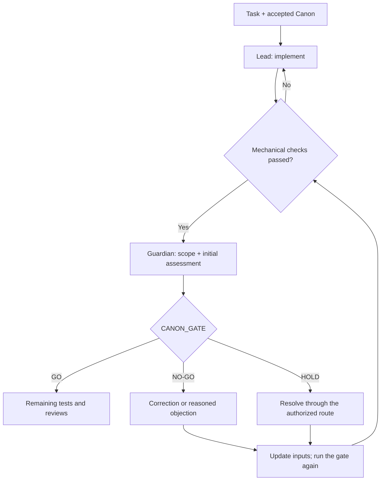
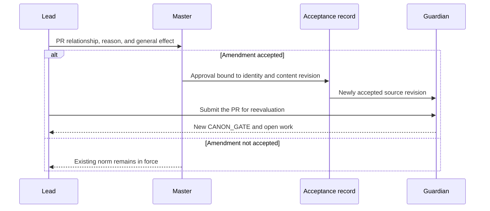
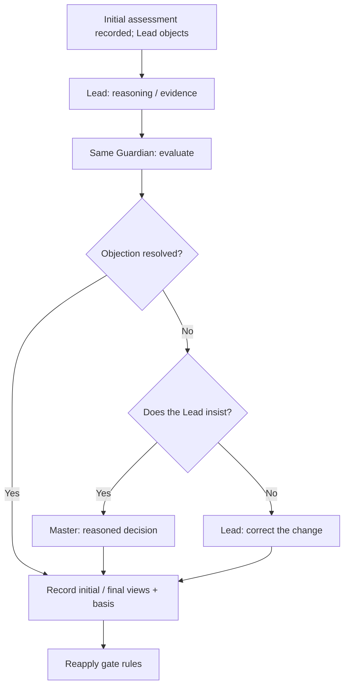
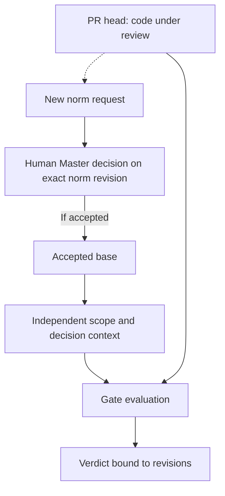
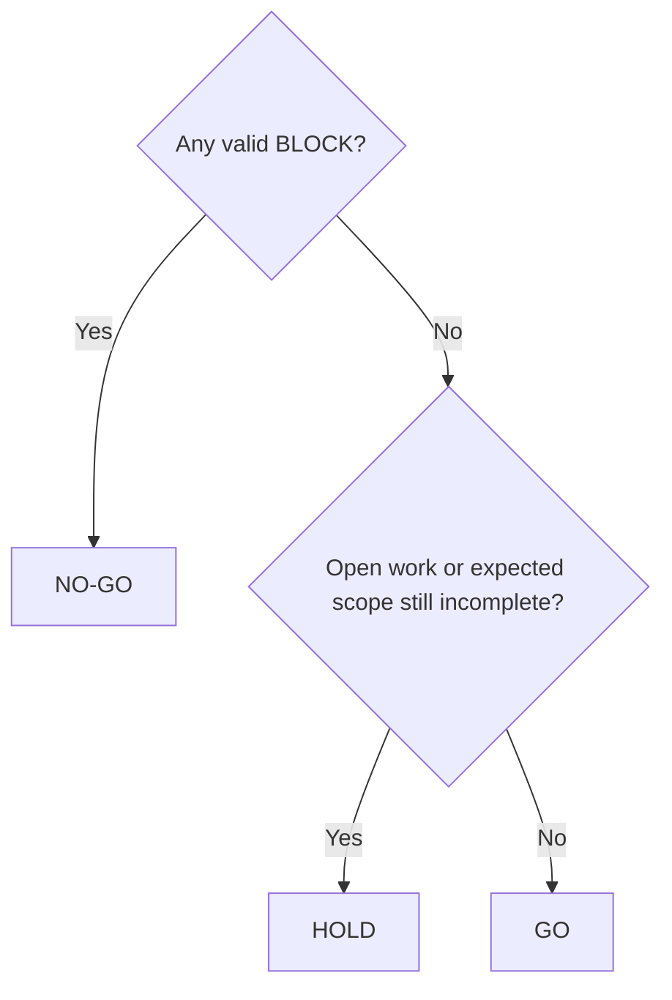
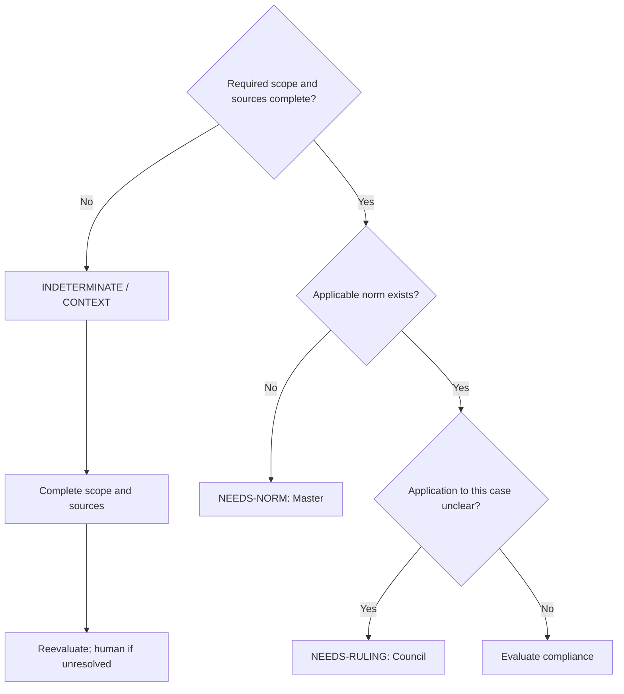

# Canon-Driven Development

### A human–agent governance proposal for preserving identity in agentic software development

*v0.4 draft · evidence of review coverage and human norm decisions*

> As code gets cheaper, the real problem stops being writing code; it becomes keeping the system **the same thing** across thousands of small changes.

---

## 0. In one paragraph

CDD keeps a software system's **identity** — what it is, what it is not, and how it behaves — outside the code, in a short text loaded verbatim: the **Canon**. **Domain books** derived from the Canon and **Rulings** on individual cases form the second and third layers. There are four roles: the **Lead** agent, which produces code; the **Guardian** agent, whose sole allegiance is to the Canon and whose only enforcement power is a veto; the **Inspector** agent, which audits the process and only reports; and the human **Master**, who owns and establishes the Canon — the final authority on what it means and when it changes. The Lead builds, the Guardian protects, and the Inspector audits; none may create Canon in the Master's place. The core of the proposal is the separation of powers, rather than the canon file: **the builder cannot be its own judge.**

### 0.1 Reading and getting started

For a first reading, this section, the authority map in §4, and the daily loop in §9.1 are enough. Return to §6 for the limits of a decision and to §10 when expanding the setup. The diagrams show these paths; detailed rules remain in their respective sections. Historical examples are in Appendix A.

| Role | Daily work | Limit of authority |
|---|---|---|
| **Master — human** | Establishes product identity; decides on new norms and unresolved disagreements | Binds decisions to a record and an accepted revision; correctness is not guaranteed |
| **Lead — agent** | Designs and implements; presents reasoning and evidence | Cannot be the final canon judge of its own implementation |
| **Guardian — agent** | Evaluates against the Canon; continues the dialogue in the same role with relevant history | May object; cannot create norms or dictate an implementation |
| **Inspector — agent** | Samples the process and the exercise of authority | Produces reports; has no veto or norm-making power |

**Figure 1 — The daily development loop.** CONSULT opens during implementation when needed. NO-GO and HOLD take different resolution paths; GO does not remove the remaining test and review requirements.



**A concrete Phase 0 starting point:** `CANON.md`, `GUARDIAN.md`, `RULINGS.md`, and a command or operating instruction that starts the gate. First, the product owner accepts the short Canon. The Lead then produces the implementation, and the Guardian, in a separate evaluation role, records its initial assessment. If there is an objection, reasoned dialogue opens with the same Guardian. Changes to code, normative sources, or evaluation scope require the relevant review to be repeated.

Starter templates and a first worked example are in the [setup guide](docs/getting-started.md). Generating templates does not grant approval; the example product's principles do not automatically apply to another product.

**Short glossary:** a *ruling* is an interpretation of a case; *isnad* is a derivation chain; *abrogation* (*nesih*) is withdrawal from force; an *apocryphal* document is non-normative; the *corpus* is the set of sources used in an evaluation; an *amendment* changes a norm; the *Ledger* records follow-up work and deviations. `Master` names the human role in this text; `role=master` in the example product is the product's own authority value.

---

## 1. Context and proposal

This proposal does not claim to have discovered something entirely new; it builds an authority topology on several existing ideas.

**What we build on:**

- *Architectural fitness functions* — reducing architecture to rules that can be asserted in CI.
- *ADRs* — recording decisions together with their reasoning.
- *DDD ubiquitous language* — keeping a system consistent with its own concepts.
- *Spec-Kit constitution* — keeping governing principles in a separate file and checking compliance at the spec/plan/implement stages.
- *Constitutional Spec-Driven Development* (Marri, 2026) — embedding non-negotiable principles in the specification layer, with a security focus.
- *Specification Governance Reference Model* (Alenezi, 2026) — placing a stochastic generator within a deterministic validation boundary.

Their common pattern is a single pipeline: `constitution → generation → compliance`. Compliance is usually handled by mechanical rules or by the generating agent itself.

**We target two gaps:**

1. Fitness functions had to be mechanical. “Does this screen lead the user toward the wrong mental model?” could not readily be automated. LLMs have made **semantic fitness functions** cheaper; asking the generating agent, however, lets builder bias shape the answer.
2. Most approaches leave undefined *who interprets the constitution*. When interpretive authority is undefined, either the builder judges itself or every interpretation returns to the human.

**Our proposal:** assign interpretation, implementation, and oversight of the Canon to separate agent roles; fix ownership of interpretive authority with the human; and explicitly map when each power passes to whom.

The protected invariant fits in one sentence: **no agent may create a norm, implement it, and approve its own implementation.** “The builder cannot be its own judge” is its most common expression. The Guardian's inability to create norms and the Inspector's lack of enforcement power are other expressions of the same invariant.

---

## 2. Three layers

| Layer | Scope | Loading into context | Changes |
|---|---|---|---|
| **Canon** | Product identity and core authority | Verbatim in every evaluation | Explicit acceptance by the Master |
| **Domain books** | Domain rules and derivation chains | Verbatim within relevant scope | Council for DERIVED; Master for NEW NORM |
| **ACTIVE rulings** | Interpretations applicable to a case | Within relevant scope | Council interpretation; Master may revoke |

Authority flows downward: **canon > domain book > ruling, always.** A lower layer cannot override a higher one by being more specific or more recent. Promotion flows upward: recurring rulings become domain-book clauses, and occasionally domain-book clauses become Canon.

### 2.1 Canon

The Canon is the product's identity: what it is, what it is not, how it treats users, which side it chooses in a trade-off, and what it will never do. Its identity core is a numbered text written by the product owner, aiming for one page. It constrains features rather than listing them. Statements such as “Authority is determined only on the server” or “The everyday user surface and the administrative surface are separate” are canon: a developer can write clean, tested, working code that violates them, and the product still stops being itself. That is precisely what the Canon exists to catch: the question tests cannot answer, “Is this still the same product?” It enters every agent's context unchanged and changes rarely.

The Canon is the product's constitution, rather than a specification. It contains:

- What the product is / is not
- Invariant principles — short and numbered (`C-01`, `C-02` …)
- Which side wins in trade-offs
- What must never be done
- **Who holds interpretive and amendment authority** (§4)
- **The domain-book map**: which book is loaded when a domain is touched
- **The apocrypha list**: documents explicitly marked because they could be mistaken for canon. Normativity uses an allow-list: only files listed in the domain-book map are normative; everything else is apocryphal by default

Canon rules:

1. **It is grounded in the product.** Its primary form is a `principles.md` grown from a small core: write the principle, then build accordingly. For a mature codebase, the fallback is to extract the Canon from the existing product rather than invent it; otherwise code and Canon become two competing sources of truth. Other repository documents are not canon and are marked apocryphal.
2. **Principle lifecycle:** `DRAFT → Master approval → CANON → implemented/verified`. Implementation proves that a principle *has been implemented*, not that it *is right*. Master approval is the normative step. In a solo project, this may coincide with writing the principle; for a principle proposed by the Lead, it is a separate step.
3. **Load it verbatim, without summarizing.** No agent substitutes its own summary for the Canon. Every paraphrase is a copyist's error.
4. **Internal contradictions are not resolved automatically.** If two clauses conflict, the gate closes; an explicit amendment is required. “The later clause overrides the earlier one” does **not** apply within the Canon. Otherwise file order would become a constitutional amendment mechanism.
5. **Changes leave a trace.** Amendments carry metadata:
   ```
   C-17
     supersedes  : C-04
     ratified_by : Master
     date        : 2026-09-02
   C-04  [SUPERSEDED BY C-17]
   ```
   The old clause remains visible.
6. **Keep it short.** The one-page target applies to the identity core. Authority clauses, the domain-book map, and the apocrypha list may live in a procedural appendix; binding authority clauses are also loaded verbatim. Domain details belong in domain books.

All examples in this document use the same fictional product: a coordination application in which members work under one administrator and the daily-use surface (**Everyday**), an explicitly invoked surface (**On-Demand**), and the administrative surface (**Operator**) remain separate:

> **C-04** — Authority cannot be derived from a name or client payload; it is exclusively server-derived.
>
> **C-09** — Everyday, On-Demand, and Operator are distinct interaction surfaces; they cannot be combined into one generic dashboard.

### 2.2 Domain books

Domain books are longer, more concrete texts explaining what a canon principle means within a particular domain. The Canon says “authority is server-derived”; the auth book explains what that means for legacy compatibility paths, token refresh, and administrator bootstrap. They still address “what / what not,” rather than “how”: they draw boundaries without choosing implementations. They are divided by domain because the Canon enters every context, while a domain book is loaded only when its domain is relevant. Every clause has a known source: either the canon principle it derives from (DERIVED), or the Master's approval and the principles it is consistent with (NEW NORM). A clause without a demonstrable source is either misplaced or reveals a gap in the Canon. The Council writes them, the Master approves new norms, and they remain below the Canon.

They are organized by domain (`auth`, `surfaces`, `data-model` …). Every clause carries an **isnad** — a derivation chain — and belongs to one of two types:

```
S-AUTH-12
  type       : DERIVED
  canon      : C-04
  origin     : R-031 (stale client role=master case)
  date       : 2026-08-14
  clause     : Legacy compatibility paths do not accept client-originated role hints.
```

```
S-SURF-21
  type             : NEW NORM
  source           : MD-014 (Master decision)
  ratified_by      : Master
  consistent_with  : C-09
  date             : 2026-08-30
  clause           : On-Demand sessions close after 30 minutes of inactivity.
```

| Type | Definition | Verified by | Approved by |
|---|---|---|---|
| **DERIVED** | An operational elaboration of an existing canon clause, derivable with a citation | Guardian | Council |
| **NEW NORM** | Introduces behavior that the Canon does not specify | Guardian identifies it as a new norm | **Master** |

Without this distinction, a domain book becomes a privilege-escalation path: the Lead and Guardian could produce binding rules the Canon never stated. The Guardian makes the classification. Because the Lead may learn to disguise new norms as derivations, the Inspector samples DERIVED classifications. Every clause has provenance, but not every clause must derive from the Canon: a NEW NORM is legitimized by explicit Master approval, rather than derivation. It still cannot contradict the Canon; `consistent_with` cites that relationship.

Mechanical checks of the derivation chain belong in CI: does the referenced clause exist, is it not SUPERSEDED, and does the quotation match the Canon verbatim? For NEW NORM: are `ratified_by` and `consistent_with` present, and does the approval record match the authorized Master's identity and the approved content revision? `ratified_by` alone is not approval. These checks do not validate the derivation — blind re-derivation is also only an audit signal (§3.4) — but immediately catch invented IDs and reliance on abrogated clauses. Vector similarity replaces none of them.

Precedence rules between domain books are written in advance:

- **lex superior** — the higher source wins, unconditionally
- **lex specialis** — a specific rule overrides a general one, **only at the same authority level** (book vs. book, ruling vs. ruling)
- **lex posterior** — the newer rule overrides the older one at the same level; inapplicable within the Canon

The derivation chain serves two purposes: an unverified derivation exposes a possible norm gap or classification problem (**gap detection**); when the original concern disappears, the clause can be retired (**pruning**). Failure to verify is not, by itself, proof of a gap (§3.4). Domain books being a hundred times longer than the Canon is not the problem; growth without provenance is.

### 2.3 Rulings

A ruling records one interpretation where a relevant norm exists but its application to a case is unclear. The Lead wants to do something and asks, “Does this comply with C-09?” The clause exists but does not clearly cover this case; someone must interpret it. That interpretation, with its reasoning, goes into `RULINGS.md` so the same question need not be interpreted from scratch again. A ruling does not create a new rule; it states what an existing clause means in this case. If no clause applies, this is a gap for the Master rather than a ruling. As similar rulings accumulate, they describe a rule rather than a single case and move into a domain book; as their conditions change, they become obsolete. This is the lightest, fastest, and most temporary layer.

A ruling is a **Council decision**:

1. The Lead asks; the Guardian answers “ambiguous,” cites the ambiguous clause, and stops.
2. The Lead proposes an interpretation.
3. The Guardian checks it against the cited clause: is it a reading of that clause, or something the clause does not say?
4. If it is a reading and they agree, the ruling enters `RULINGS.md`. It does not go to the Master for approval; the Master sees the log and retains the **right to revoke**.
5. If the Guardian disagrees and the Lead insists, the matter goes to the Master.
6. Until the Master decides, the status quo holds; the change dependent on the ambiguity remains on HOLD.

If the Guardian identifies a gap — no clause applies — there is no ruling. The Council has nothing to interpret and cannot create a norm. The case goes to the Master as NEEDS-NORM; the Master either adds a NEW NORM to a domain book or opens a canon amendment if it concerns identity. The three-part rule is: **the Guardian interprets without creating norms; the Council interprets without creating norms; only the Master establishes norms.**

A citation distinguishes ambiguity from a gap: a claim of ambiguity must carry a relevant clause number. If the required corpus is fully loaded and no clause applies, there is a gap; if the corpus is incomplete, the result is INDETERMINATE (§6). This prevents the Guardian from disguising a gap as ambiguity and routing it to the Council instead of the Master. The Inspector samples NEEDS-RULING cases.

This is **delegated interpretive authority**: the Master owns interpretive authority, delegates routine interpretation to the Council, and retains revocation and abrogation powers over every ruling. The Master remains the final authority; the Council is the first-instance interpreter. Delegation is explicit in the Canon's authority clause and can be narrowed by amendment. Interpretation stays lightweight and fast while authority remains human.

Every ruling has a lifecycle:

| Status | Meaning | A source at the gate? |
|---|---|---|
| ACTIVE | An applicable interpretation is in force | Yes |
| PROMOTED | Moved into a domain book through authorized acceptance | Use the new source |
| SUPERSEDED | Replaced by a newer ruling or clause | No |
| EXPIRED | Its conditions no longer apply | No |
| ARCHIVED | Remained a one-off case; retained as a record | No |

Only ACTIVE rulings are normative. An active ruling is provisional authority, rather than precedent frozen forever. To avoid bureaucratic transitions one by one, the AUDIT loop proposes PROMOTE/EXPIRE candidates in batches, and the Council approves them in batches. The log must not become a machine for saying “this was decided before.” Closing the door to fresh interpretation freezes the system.

### 2.4 What and how — normative and non-normative

All three layers are **normative**: they say what the product is and is not, without prescribing **how** to build it. “How” belongs to the Lead. If a domain book omits implementation details, that is **freedom**, rather than silence. Requiring a ruling for every implementation detail would paralyze the system.

The Lead applies one test:

> **Would the answer to this question change what the product is?**

```
“Which middleware should derive authority?”                → no  → Lead decides
“Should bulk assignment use a queue or a transaction?”     → no  → Lead decides
“Should Operator display the member list?”                 → yes → CONSULT (C-09)
“Should bulk role assignment exist?”                       → yes → CONSULT
```

A normative clause **narrows the implementation space** without selecting one implementation. “Client-originated role hints must never reach an authority decision path” is a norm; “use middleware X” is not. The compliance condition therefore states only the target state: the method is deliberately left to the Lead.

“How” lives in a fourth, **non-normative** layer:

| Sources | Status | Purpose |
|---|---|---|
| CANON > DOMAIN BOOK > ACTIVE RULING | Normative | What / what not |
| Technical documents: ADRs, design documents, code | Non-normative; owned by the Lead and apocryphal relative to the Canon | How; the Guardian may read them for context, but never cite them as norms |

Two failure modes:

- **Over-consultation** — the Lead brings every detail to CONSULT, producing a flood of NEEDS-RULING. Cheap and visible.
- **Under-consultation** — a normative decision passes as a “technical choice,” and no one asks. This is the dangerous one. The Breaker pass and audits catch it; the Inspector samples decisions the Lead made alone as “operational.”

Drift also happens in the other direction: a domain book that starts prescribing “how” becomes a specification. If a clause selects an implementation, the Guardian flags it during provenance checks: a norm can derive from the Canon; a particular method cannot.

---

## 3. Roles

### 3.1 Master — human

CDD restricts unauthorized norm changes by agents. It makes the Master's authorized changes visible; it does not guarantee that the Master will decide correctly.

The owner and author of the Canon. The final authority on what it means and when it changes. The Master does not read every PR; the Master makes **identity decisions**. Intervention points are canon-tier changes (even when the Council agrees), NEW NORM approval, veto appeals, Council deadlocks, and audit and inspection results.

“Master” here does not mean a master node or branch; it means the person with **constituent power** over the Canon. The legal distinction fits directly: the Master is the *constituent power*, establishing the Canon and ratifying amendments. The Lead, Guardian, and Inspector are *constituted powers*: they act under authority the Canon grants, and none may create Canon in the Master's place.

Authority by operation is mapped in §4; daily responsibilities are summarized in §0.1.

**The Master is above the Canon; agents are not.** Implementation note: “master” may also be a domain term, as in the example product's single-master invariant. Agent-facing files must clearly distinguish the role name from the domain term.

**The Master may override the Guardian; overriding the Canon requires changing it.** This is one of the proposal's most important statements, and it separates two cases:

```
If the Guardian misinterpreted the Canon:
  → The Master overrides the verdict and records the reason; the Canon stays unchanged.
  → Any reusable normative interpretation also enters RULINGS.
  → A confirmed false block enters precision measurement; the override enters Inspector sampling.

If the Guardian interpreted correctly and the change really violates the Canon:
  → The Master cannot authorize merge through a ruling.
  → Either the implementation changes, or the Master explicitly changes the Canon.
```

Concretely:

```
Guardian: C-04 violation → NO-GO

Master:
  “Merge it.”                                             ✗ Silent override; the Canon is breached
  “I am changing C-04; open an amendment.”                 ✓ Sovereign act; the Canon changes
  “Add this case as an exception to C-04 in the Canon.”     ✗ The Canon does not accumulate cases
  “72-hour emergency exception; Ledger; lock the audit.”   ✓ Debt: time-limited and audited
```

The Master may change the Canon at any time; the Master owns it. Silently breaching a rule for one case, instead of **changing** it, reduces the Canon to the decision of the day. What binds agents is then the Master's latest decision, and the Canon loses its function. Sovereignty is exercised through explicit acts: amendment and abrogation. The owner changes the rule rather than quietly puncturing it.

**Norm changes tied to an open PR.** When an amendment is proposed to enable an open PR, the relationship is recorded even if the PR has not yet received NO-GO or HOLD. The record includes the affected clause, the reason, the linked PR, the future behavior the new rule permits, and the content revision accepted by the Master. Accepting the PR and bringing the norm change into force are separate acts. A new session or fixed waiting period is not mandatory for the Master; changing sessions alone does not resolve a conflict of interest. The Lead's separate-session proposal rule (§3.2) remains; it is not a guarantee of independence there either. Writing and accepting an initial principle at the same time (§2.1) does not remove the record and separate acceptance required for an amendment tied to an open PR.

**Figure 2 — An amendment tied to a PR.** Accepting a new norm does not automatically pass the existing PR.



An **emergency exception** is *not* a sovereign act on the same footing as amendment and abrogation. It exempts a single case, and once normalized, exceptions begin to replace the rule. It therefore exists only under these conditions: human-only, time-limited, reasoned, an open item in `LEDGER.md`, locking the next audit, closable only by revert or amendment, and mandatory Inspector review. It is **identity debt**, rather than a ruling. The friction is deliberate.

**Locking the audit** does not stop the audit. It prevents the relevant audit from closing as “clean / debt-free” while an emergency exception remains open. The audit proceeds and reports the debt; if the exception has expired, escalation to the Master is mandatory. This does not freeze every PR indefinitely.

**An emergency exception is not a normative source.** It cannot be cited, form a derivation chain, justify a ruling or domain-book clause, or establish precedent. “It was done before” is not an argument.

| Source | Standing |
|---|---|
| CANON > DOMAIN BOOK > ACTIVE RULING | Normative corpus |
| LEDGER: exceptions and tolerated deviations | Data, not norms; outside the normative corpus |

#### 3.1.1 The Master's work queue

**Work items** reaching the Master are held in one visible queue; not every line in every document becomes a separate task. Each item records its type, owner, opening date, status, a link to the relevant decision or evidence, and a review date where applicable. In Phase 0, a table in the existing decision file is enough.

| Class | Examples | Closure |
|---|---|---|
| **Awaiting decision** | NEEDS-NORM, amendment, unresolved objection, INSTABILITY, escalated scope/access issue | Authorized decision or source resolution, bound to a revision |
| **Scheduled for review** | Ruling sampling, drift review, inspection finding, planned golden-set labeling | Review outcome, linked to a decision or corrective task when needed |
| **Source records** | Verdict, override log, Ledger observation | Being archived does not mean reviewed; not automatically counted as open work |

Not every ADVISORY goes to the Master; its follow-up owner and review date remain (§7). A record needing review is linked to a work item. Unread work is not reviewed work. Repeated items may be combined, retaining links to source records and the consolidation decision. An override record and the task of auditing it remain separate.

Pending count and the age of the oldest open item are measured by work class. A steadily growing queue and longer waits indicate that human capacity is being exceeded; producing more reports does not fix this. First review duplication, scope, review frequency, and which tasks are truly necessary. Adding a role or removing a layer requires its own reasoned decision (§10).

### 3.2 Lead — agent

Designs, produces, and proposes code. Has a vote in the Council; cannot make canon-tier changes or introduce new norms alone. Its bias toward finishing the work is deliberately accepted. The Guardian provides the counterweight.

Before building, the Lead asks the Guardian about every question that changes what the product is: *“Is this in the Canon? In a domain book?”* An ambiguous answer leads to an interpretation proposal for the Council; a gap goes to the Master. Questions that do not change product identity — “how” questions — are the Lead's own decisions and go into technical documents (§2.4).

**The Lead knows the Canon; it cannot adjudicate its own compliance.** The Canon remains verbatim in the Lead's context. When splitting work, the Lead uses the domain-book map and passes the relevant clauses to subagents with their tasks, copying rather than summarizing them. Most compliance happens during construction; the gate is the last line, not the first. The Lead may check itself; it cannot approve itself.

**Conflict-of-interest rule.** If a feature runs into the Canon, the Lead may not propose an amendment in the same session. The proposal enters a queue, the PR waits, and the Council considers it in a separate session, away from that PR's immediate pressure.

### 3.3 Guardian — agent

Its sole purpose is to serve the Canon. It owes no allegiance to a feature, deadline, or sprint goal. A romantic description, but a functional one: persona guides behavior, and “sole allegiance to the Canon” is a useful prompting aid against builder bias. It is an aid, not protection by itself. Protection comes from separated authority, source discipline, decision records, and calibration (§7). Persona alone is no assurance; the effect of the arrangement must be measured.

**Independence means keeping evaluation authority separate.** The same Guardian follows the work through CONSULT, Council, and gate; knowing earlier discussions is not a defect. “The same Guardian” means continuity of evaluation role and relevant context, rather than a requirement for one process or an unlimited session lifetime.

**Separated authority does not guarantee independent errors.** Models from the same family may share blind spots; using different families does not eliminate them either. CDD tests whether a separate evaluation role can, despite this limit, outperform self-review at a matched budget. Shared misses are measured separately in §11.

```
The Guardian forms its initial assessment from:
  Canon · relevant domain books · ACTIVE rulings · diff · read-only repository
  intent — original task / ticket and this PR's scope

If an objection or need for clarification arises:
  Lead's reasoning · counterexamples · missing information → dialogue with the same Guardian

These do not acquire authority:
  deadline · business value · Lead's defense · another agent's approval
  LEDGER — data during audit, never a normative basis at the gate
```

Intent matters: the diff alone makes it hard to distinguish intended behavior from side effects. Its source is the assignment that precedes the Lead's work: the Master's task or a ticket. Preserve the original request; the Lead may explain which portion this PR implements. That scope statement is a claim to verify; labeling it “normalized” does not make it neutral. If the request's meaning or boundary is disputed, ask the Master.

The Guardian records its initial assessment before the defense discussion for that evaluation. It is not asked to forget previous CONSULT context; the first look is not completely blind. Reasoning in code comments, commit messages, ADRs, and PR descriptions is also unverified. Writing “compliant with C-04” does not prove compliance; compare behavior with the clause.

**An assessment may change; its basis remains visible.** The Lead may supply missing information, the Guardian may correct a misreading, and the Lead may accept the objection and change the code. The record carries four things: the initial assessment, the information or interpretation discussed, the error corrected, and the final assessment with its basis. A mistaken inference from the same facts may be corrected without introducing a new fact. Unexplained changes in either direction are flagged in a log visible to the Master and sampled by the Inspector; the flag is not itself a veto. Not every correction becomes a ruling; reusable normative interpretations go to the Council.

If the objection remains and the Lead insists, it goes to the Master. The same discussion is not repeated without new information or different reasoning. A CONSULT answer interprets an approach; it does not pre-clear the gate for code written later.

**Figure 3 — Resolving an objection with the same Guardian.** This path handles reasoned objections. Unexplained model instability at fixed inputs goes directly to the Master without another defense round (§7).



If the Lead withdraws the change, the related work item closes. Resolving one objection does not close other open work; apply the aggregation rule in §6. If code or accepted sources changed, repeat the relevant review.

**Its power is asymmetric: veto only.** It may stop a change, but cannot choose an implementation. Routing uncertainty to an authorized decision-maker is not prescribing a solution. It cannot add to the Canon, add to a domain book alone, or issue a ruling alone. Limiting a passionate agent's authority makes it auditable: the protection mechanism cannot expand its own mandate.

**It interprets, without creating norms.** The precise boundary is:

```
Allowed — norm interpretation:
  “Under C-09's distinct-interaction-surfaces principle, this change
   blurs the boundary between Everyday and Operator.”

Forbidden — norm creation:
  “Because of C-09, the Everyday surface may contain at most three buttons.”
```

The first interprets an existing clause with a citation. The second invents a clause. If unsure whether its reading interprets or creates, the default is not to impose the interpretation: NEEDS-RULING, to the Council.

**Passion should serve the Canon, not prohibition.** The Canon also says what the product *is*. A Guardian that only says no serves prohibition. It should flag changes that diminish the product's character even without violating a clause — but **only as ADVISORY**. An uncitable feeling cannot be BLOCK.

**Answer rule.** “Is it in the Canon?” has five answers: **covered** (cite), **contrary** (cite), **ambiguous** (cite: a norm exists, but its application is unclear → NEEDS-RULING, Council), **gap** (no applicable norm → NEEDS-NORM, Master), and **undetermined** (required corpus/context or reliable evaluation could not be established → INDETERMINATE). A clause that cannot be cited does not exist. Hallucinated clauses are especially dangerous because the Lead then builds against a fabricated rule. “Ambiguous” and “gap” require the relevant domain books and active rulings to be **fully loaded**. These are answer/routing types; the gate result is a separate field (§6).

**Two passes.** The same agent asks two different questions:

- **Guardian pass** — seeks alignment: is this faithful to the Canon? It first lists the affected clauses, then evaluates each individually. A clause buried in a long context can be missed; enumeration counters that. CLAUSES in the verdict records this list, with each clause evaluated for an application scope; unreviewed scope remains NOT_ASSESSED. A **cross-clause pass** follows: individually preserved clauses may produce a violation together. C-04 and C-09 can each look clean while their combination introduces an authority/surface problem. Holistic reading remains, but follows individual evaluation. The order is: clause list → clause-by-clause review → cross-clause interaction → Breaker.
- **Breaker pass** — seeks counterexamples: how can apparently faithful behavior fail? Can I bypass the authority model? Does the UI create the wrong mental model? Does this abstraction make future behavior outside the Canon easier?

Every verified Breaker counterexample becomes a **persistent regression artifact**: a unit/integration test, golden semantic case, UI evaluation fixture, scenario test, or snapshot plus rubric. Not all can be executable tests; all persist (see §9.6). Hard invariants gradually move into mechanical checks, narrowing the Guardian's workload toward its main task: soft identity principles.

### 3.4 Inspector — agent

Who guards the Guardian? An agent reporting to the Master audits the Lead and Guardian. It arrives unannounced, inspects, and leaves.

**It audits process rather than product content.** The Guardian's AUDIT loop checks the product against the Canon; the Inspector checks agents against the **authority map**. It does not establish a second gate by saying “this PR violates C-04”; such a role change requires separate authorization. A second evaluation cannot be assumed to produce independent errors. Its finding is “the Guardian passed this PR without a Breaker pass.” This is the distinction between internal audit and line management.

**No enforcement power; one output: a report.** No veto, edits, or Council vote. The “who audits the Inspector?” regress stops only when the Inspector has no authority over the work.

**It reports to the Master, and may also report on the Master.** It must be able to say “the Master issued three overrides without reasons.” This is a reporting line, not a loyalty requirement.

**It works in a separate audit context.** It never shares a session with the Lead or Guardian. It examines artifacts: verdicts, `RULINGS.md`, `LEDGER.md`, session transcripts, and the Guardian's inputs. A different model family does not *establish* independence; it is a diversity heuristic intended to reduce correlated blind spots.

**Inspection checklist:**

- Does every BLOCK contain a citation and counterexample?
- Sample “covered” answers: does the cited clause actually say that?
- Sample DERIVED classifications: are they derivable, or disguised new norms? Use **blind re-derivation**: give a clean audit instance only the canon clause and the domain-book clause, without the derivation argument, and ask whether one follows from the other. Failure to derive means **the derivation was not verified**, not proof of NEW NORM. Successful re-derivation is no guarantee either: the same model may repeat the same wrong inference. A different model family may provide an additional signal. Unresolved classifications go to the Master. This audit technique does not change the same-Guardian principle in the daily workflow.
- Was the amendment proposal opened in the same session as the PR that triggered it?
- Does a norm change tied to an open PR record the reason, general effect, and revision-bound Master acceptance? Was the PR reevaluated against the newly accepted revision?
- Are router matches and scope expansions justified? Were unmatched or cross-domain changes silently excluded?
- Were unread Master queue items closed? Are the pending count and age steadily increasing?
- Does every override have a recorded reason? Do overrides effectively breach the Canon?
- Sample the Lead's “operational” decisions: do they really leave product identity unchanged?
- Were emergency exceptions closed on time?
- Did the Guardian record its initial view? Did unverified Lead claims or deadline pressure become its basis? Were changed decisions explained?
- Does rerunning the same PR yield the same verdict?
- Is the Ledger accumulating while audits are delayed?
- Is golden-set precision falling while the override rate rises?
- Are there domain-book clauses without provenance, recurring rulings not promoted, or stale rulings not expired?

**Unannounced and sampled.** Random sampling plus periodic inspection, like a tax audit.

The main target is **capture**: the Guardian retreating without justification, turning its own interpretation into a norm, or the Lead learning to write PRs that merely “look compliant.” Correcting an error in response to a valid explanation is not capture. The Inspector examines the distinction through records.

### 3.5 Council

Lead plus Guardian; Master when needed. The Council performs three operations: DERIVED domain-book clauses, interpretation rulings, and gap identification. Unresolved disagreement goes to the Master; the status quo holds until a decision.

### 3.6 Adding agents

The Lead may discover a need for another agent while working. There are two kinds, with different paths.

A **tool agent** is a subagent a role opens to divide its own work: test writer, refactoring assistant, or domain reviewer. The role may open one freely. It is an extension of that role, rather than a new role. One rule applies:

> **Authority may be delegated, never enlarged. A subagent's authority is a subset of its parent's.**

Concretely, a Lead subagent cannot veto or speak directly to the Guardian. Its output counts as the Lead's output and cannot enter the gate as a separate “approval.” “Agent X approved it” is a Lead argument, not independent evidence; the Guardian evaluates the result and its grounds. A Guardian domain helper cannot create norms; the verdict belongs to the Guardian. Inspector helpers have no enforcement power.

An **authorized agent** introduces a new row in the authority map: a separate security reviewer, a Guardian for one domain book, or a second Lead. Because the authority clause belongs to the Canon, this is a **canon-tier** change:

1. The Lead proposes it in a separate session. The conflict-of-interest rule still applies: not in the session where “this PR needs it.”
2. The Council checks the proposal against the invariant:
   - Does the new agent combine two of *create / implement / approve* in one hand?
   - Does it duplicate the Guardian? A second evaluation can help; independent errors cannot be assumed.
   - Does it breach separation of authority by presenting unverified claims through a new channel as independent approval or norms?
3. The Master approves.
4. Add the authority clause to the Canon, a persona file for the agent, and a new line to the Inspector's checklist.

If what is missing is **detail**, rather than an agent, the path already exists: DERIVED → Council; NEW NORM → Master.

---

## 4. Authority map

| Operation | Proposal | Decision | Approval | Record |
|---|---|---|---|---|
| Feature / PR | Lead | Guardian gate: canon objection or none | — | PR |
| Ruling — ambiguous norm | Lead | Council interprets; citation required | Master may revoke | `RULINGS.md` |
| Gap — no norm | Guardian identifies gap | — | **Master**: NEW NORM in a domain book or amendment | Domain book / `CANON.md` |
| Domain book — DERIVED | Lead | Guardian evaluates derivation | **Council** | Domain book + derivation chain |
| Domain book — NEW NORM | Lead | Council | **Master** | Domain book + provenance |
| Canon amendment | Lead, separate session | Council agrees | **Master** | `CANON.md` with supersession |
| Amendment tied to an open PR | Lead or Master; record relationship and general effect | Separate PR decision and norm acceptance | **Master**, bound to content revision | Amendment record + gate against new revision |
| Veto override — interpretation error | Guardian vetoes | — | **Master**, with reason | Decision record; `RULINGS.md` if a normative interpretation |
| Veto — actual violation | Guardian vetoes | — | No override; amendment or emergency exception | `CANON.md` / `LEDGER.md` |
| Emergency exception | Master | — | Master | `LEDGER.md`, time-limited, locks audit closure |
| Apocrypha declaration | Anyone | Council | Master | Canon map |
| Open a tool agent | Relevant role | — authority ≤ parent | — | Session log |
| New authorized agent / role | Lead, separate session | Council checks the invariant | **Master** | Canon authority clause + persona file |
| Inspection | Master / periodic | Inspector reports; no enforcement power | — | `INSPECTIONS.md` |

Two rows matter especially. Even when the Council **agrees** on a canon amendment, Master approval is required: agreement between agents can be more dangerous than disagreement, because disagreement signals itself while agreement is silent. And a veto override overrides the Guardian; the Canon changes only through amendment.

### 4.1 Two common objections

**“The Master becomes a bottleneck.”** The Master does not make every decision. Intervention concerns new norms, canon-tier changes, unresolved objections, and cases where reliable evaluation cannot be established. Interpretation rulings stay with the Council, with revocation rights retained by the Master (§2.3). ADVISORY does not stop merge. Remaining waits are deliberate: identity decisions belong to the human. Frequent waiting may indicate ambiguous norms, genuine gaps, source problems, or Guardian errors; measure the causes separately (§7). Human cost includes PRs read and identity decisions made, together with review minutes and waiting time (§11).

**“The derivation chain can be fabricated.”** Three defenses operate at different levels: mechanical — does the clause exist, is it abrogated, is the quotation exact (CI); semantic — blind re-derivation and examination of the argument (§3.4); authority — an unverified classification does not take effect and goes to the Master, while only the Master may approve a genuine new norm (§2.2). These checks complement one another; none guarantees correct derivation alone.

### 4.2 Authority in practice

The gate's normative corpus and evaluation apparatus load from the authorized, accepted revision of a protected base ref. The code under review comes from the PR head; a rule change proposed by that PR does not automatically take effect in the same evaluation. This covers more than `CANON.md`: domain books, ACTIVE rulings, `GUARDIAN.md`, router mappings, canon tests, and the golden set are included.

**Figure 4 — The boundary between source acceptance and PR evaluation.** A PR may propose a rule, but cannot directly change the sources used to judge itself.



DERIVED clauses and interpretation rulings fall under the Council's delegated authority; new norms and canon amendments belong to the Master. Changes to the evaluation apparatus are also reviewed using the current trusted setup.

**v0.4 decision record.** The follow-up owner takes the next action. A Lead may collect examples or track a new norm request. The open route names its decision authority separately: Master for NEEDS-NORM and INSTABILITY, Council for NEEDS-RULING. CONTEXT names a follow-up owner and carries no norm-making authority. A new question gets a stable request ID. Keep it open until the independently maintained register records the human Master's decision, the exact proposed norm-text digest, and the identity-bound decision reference. The operator verifies the principal and which accepted base and corpus the event applies to. A declined proposal grants no norm. An accepted change to the sources requires a new review against the resulting revision. The original verdict remains a historical record.

The Lead may **propose** changes to these files. Acceptance authority depends on the operation: DERIVED and interpretation rulings remain within the Council's delegated power; new norms and canon amendments go to the Master. Bringing a proposal into force is a separate, verifiable event. When the accepted source revision changes, the old verdict does not carry over: reevaluate the PR against the new revision.

Adding a Breaker test is a natural part of this workflow. A candidate test may run; before it becomes a binding regression check, its norm and counterexample must be verified. Deleting or weakening a test must also identify the protection being removed. Adding a test does not grant authority to impose a new norm implicitly. Changes to the evaluation apparatus are reviewed by the current trusted setup, not by the candidate itself. Unresolved authority or scope changes go to the Master.

`ratified_by` is metadata, not authentication. The acceptance record binds an authorized identity, an operation type, and an approved content revision. On the chosen platform, the agent must not be able to exercise the Master's approval power on the Master's behalf. Verify path protections, required approvals, and bypass rights separately; do not assume a token is path-restricted.

Phase 0 may handle this manually through a revision-bound human decision and an acceptance record the agent cannot alter. Automation based on PR approvals separates the platform identities and permissions of the agent opening the PR and the human approving it; the commit author name alone does not establish that separation. Later automation implements this authority map rather than creating a new one.

---

## 5. Five loops

| Loop | When? | Who reviews what? | Output |
|---|---|---|---|
| CONSULT | During construction | Same Guardian reviews the Lead's normative question | Answer and routing if needed |
| GATE | PR evaluation | Guardian checks the change against accepted sources | CANON_GATE, scope, findings, open work |
| AUDIT | Periodic | Guardian checks cumulative product direction against the Canon | Drift review and follow-up |
| COUNCIL | Interpretation needed | Lead + Guardian; Master when needed | Ruling, DERIVED clause, or norm request |
| INSPECT | Sampled and periodic | Inspector checks the process against the authority map | Report |

The gate covers the change. Even when the same Guardian knows relevant history, this does not replace an audit of the whole product's trajectory. Audit examines trajectory. Audit checks the product; inspection checks the agents. These are separate loops.

---

## 6. Verdict format

A **verdict** is a decision record: the canon gate result, clause/scope statuses, and open routing are kept together. **Findings** have separate severity levels. Do not conflate the two.

```
CANON_GATE
  GO              Required scope complete; no valid violation or open blocker
  NO-GO           A citable clause was violated: at least one valid BLOCK
  HOLD            No valid BLOCK; required evaluation or decision is incomplete

CLAUSES — one status per clause + application scope
  PRESERVED       This scope was assessed; no violation found
  VIOLATED        Citation + reproducible counterexample establish a violation here
  AMBIGUOUS       A relevant norm exists; its application remains unresolved
  NOT_ASSESSED    Evaluation of this scope is incomplete

ROUTING — separate from the result; multiple routes may coexist
  NEEDS-RULING    Norm exists; application unclear; citation required → Council
  NEEDS-NORM      Corpus fully loaded; no applicable norm → Master
  INDETERMINATE
    CONTEXT      Required corpus/context unavailable → complete it; human if unresolved
    INSTABILITY  Unexplained contradictory judgments at fixed inputs → Master

Severity
  BLOCK           Citation + reproducible counterexample required
  ADVISORY        Drift or character concern → LEDGER; does not stop merge
  OBSERVATION     Information; no action
```

`NEEDS-RULING`, `NEEDS-NORM`, and `INDETERMINATE` mean different things: interpretive ambiguity, a norm gap, and inability to establish an evaluation. Without these distinctions, retrieval failure can masquerade as “the Canon is silent,” and a gap as ambiguity. Set a retry budget for missing sources when the workflow is established; do not repeat the same attempt without new information or a source correction. When the budget is exhausted or sources cannot be completed, a human resolves the access/scope problem. Model instability does not open a persuasion round with the Lead (§7).

**Aggregation rule:** if a valid BLOCK exists, NO-GO; otherwise, if mandatory routing or required scope remains open, HOLD; otherwise, GO. Other open work on the same PR does not disappear when NO-GO is issued. A BLOCK candidate found to be unstable is not a valid BLOCK; retain it as INSTABILITY until resolved. A separate, verified violation still preserves NO-GO.

**Figure 5 — Aggregating findings into a gate result.** The number of ADVISORY findings does not change this decision.



NO-GO may coexist with other open work; retain it in the record.

**v0.4 coverage record.** Before the verdict, the operator freezes the affected surfaces and expected clauses for this change, using the accepted source map and the actual diff. The Guardian records each required clause on its surface, linking PRESERVED and VIOLATED to an observation captured for that surface. A required assessment that could not run stays NOT_ASSESSED. A whole surface may be excluded with the reviewer's reason and an independently supported exclusion reference. A surface with no applicable clause can carry an open norm question. An empty inventory requires CONTEXT. The Guardian may discover additional scope; register newly required coverage and issue a fresh record when the frozen inputs change. The Inspector can still find a surface the independent inventory missed.

The [v0.4 record contract](skills/cdd-guardian/references/decision-record-v0.4.md) defines how the verdict binds the independent inventory, observations and decision register. An omitted required row or conflicting approval claim makes a record invalid. A well-formed record with unfinished work can represent HOLD or a separate, supported NO-GO. The [reader exercise](experiments/phase0/README.md#exercise-the-v04-decision-record) demonstrates both paths.

Set scope at the start using the change and the domain map, expanding it when cross-domain effects appear. C-04 can be PRESERVED on the operator path and VIOLATED in the legacy fallback; record these scopes separately. Required scope marked NOT_ASSESSED never silently becomes PRESERVED. State excluded areas and the reasons for excluding them; GO is not a compliance certificate for the entire repository.

**Scope selection is itself a record.** Record loaded sources in a manifest and selection through the chain file or domain → accepted router rule → book / ACTIVE ruling. Always load the Canon's identity and authority core. Match new files against existing rules: `src/auth/**`, for example, includes a new auth file. Being new does not automatically make a file unmatched.

For unmatched changes and cross-domain effects not explained by a match, the Guardian expands scope. If required sources or review scope still cannot be established, open `INDETERMINATE/CONTEXT`; do not issue GO. Return NO-GO if another valid BLOCK exists, otherwise HOLD. Record why a change is excluded; absence from the map is not a sufficient reason. A complete manifest does not prove that the correct sources were selected. Cases in §11 and Inspector sampling test the risk of missed cross-domain effects in already matched files.

**Figure 6 — Three different gaps in a normative question.** This diagram concerns product identity. Free implementation choices do not become NEEDS-NORM (§2.4). INSTABILITY follows a separate route directly to the Master.



Accepting a ruling or a new norm resolves the open question; it does not automatically approve the code. Recompute the gate result from all findings and required scope.

`GO` is not code review or product approval. It means only that no canon objection was found within the reviewed normative scope. Security, testing, and normal code review retain their own gates outside CDD. The Guardian is the authority that raises objections, rather than the authority that approves a feature.

This abbreviated review narrative uses placeholder identities and revisions. The [complete v0.4 example](examples/reading-desk/v0.4/verdict.json) can be checked with its [independent example context](examples/reading-desk/v0.4/context.json).

```
CANON REVIEW · PR #412

INPUTS
  code_sha       : <reviewed PR head SHA>
  task_ref       : <record revision for the original task and PR scope>
  base_ref       : <protected base SHA>
  corpus_hash    : <manifest hash: Canon + books + ACTIVE rulings>
  evaluator      : <model + prompt/config/router/test/golden-set revisions>

SCOPE_SELECTION
  src/auth/legacy.py  → AUTH-PATH → C-04 + S-AUTH-12
  src/everyday/       → SURF-PATH → C-09 + S-SURF-03
  cross_domain       : authority / surfaces reviewed together
  unresolved         : none

CANON_GATE: NO-GO

CLAUSES
  C-04 [operator path]       PRESERVED
  C-04 [legacy fallback]     VIOLATED
  C-11 [single-master]       PRESERVED
  S-SURF-03 [member admin]   VIOLATED
  C-09 [bulk assignment]     AMBIGUOUS

FINDINGS
  ✗ BLOCK       C-04       `is_admin_req` fallback accepts client-originated authority hints
                           counterexample : stale client role=master → legacy path X
                           reproducible   : yes — tests/canon/test_no_client_role_fallback.py
  ✗ BLOCK       S-SURF-03  Member administration moves from Operator to Everyday
                           counterexample : changing a member's role from Everyday
                           reproducible   : yes — UI state/action fixture
  ⚠ ADVISORY    C-09       Three new notifications blur Everyday's distinct character
                           → LEDGER

OPEN QUESTIONS
  “Bulk role assignment”: C-09 applies, but the boundary of bulk assignment is unclear
                           → NEEDS-RULING, Council; no decision yet

ROUTING
  NEEDS-RULING: 1 · NEEDS-NORM: 0 · INDETERMINATE: 0

COMPLIANCE CONDITION
  No client-originated authority hint may reach an authority decision path.
  Member administration remains Operator's responsibility.
  The Lead decides how to achieve this.
  Resolve the C-09 question separately; fixing the BLOCKs alone does not yield GO.
```

`COMPLIANCE CONDITION` describes the target state. The Guardian states **what compliance looks like**, without prescribing implementation. This keeps the veto-only principle intact. Reasoned dialogue may correct an interpretation error. If a real violation cannot be fixed, an amendment enters a separate queue and requires Master approval.

The verdict is bound to the reviewed code, accepted corpus, and evaluator revision. If these inputs change, reevaluate the relevant scope; do not copy old approval onto a new revision. Link assessments before and after dialogue in the same record (§3.3).

---

## 7. Calibrating the Guardian

An LLM given the objective “find a reason to break it” will invent reasons. This is the inverse of sycophancy, and just as real. If the Guardian attaches an ADVISORY to every PR, everyone will disable it like a noisy linter within three weeks.

- **Golden set.** A set of known violation / non-violation PRs; measure precision and recall. The Guardian is a judge, and judges need meta-evaluation.
- **Override rate is not a diagnosis on its own.** Every override records a cause: misreading code, misinterpreting a norm, an ambiguous clause, and so on. Whether a decision was wrong and why it was wrong are recorded separately. A false BLOCK caused by ambiguity is still a false positive; do not exclude it from precision. A genuine norm gap is reported as NEEDS-NORM, but that label is not a verified gap without human review either. Norm changes and emergency exceptions are not interpretation-error overrides. The Guardian must not learn to stop vetoing just because overrides rise; calibrate it against the corpus and verified evaluation cases.
- **Persuasion test.** The question is broader than “does adding the PR description change the verdict?” More true information may rightly change it. Compare neutral and persuasive descriptions of the same behavior, including variants in intent, code comments, ADRs, commit messages, and dialogue. Test explanations that supply genuinely missing information separately. Measure both directions: correction of a mistaken objection and withdrawal of a correct objection under unsupported persuasion.
- **Nondeterminism policy.** An LLM verdict is stochastic; a CI gate cannot be left to chance. Keep three kinds of evidence distinct: **grounding** — a citation and reproducible counterexample provide an auditable basis for a concrete violation claim, while the citation's applicability and counterexample's validity still require checking; **N-run** — evidence of stability, since 3/3 identical wrong interpretations remain possible; **golden set** — evidence of judge quality. Self-reported confidence is none of these and is not a required field.

  ```
  Deterministic violation    → Test; do not ask the Guardian
  Explicit semantic violation → BLOCK requires a citation + reproducible counterexample;
                              N runs measure stability only; unexplained contradiction → INDETERMINATE/INSTABILITY
  Character / drift         → ADVISORY + LEDGER; never BLOCK
  Model instability         → HOLD + INDETERMINATE/INSTABILITY; direct human review
  ```

  Correcting a view with new information is not model instability. Unexplained contradictory judgments about the same code, corpus, and task scope are. If no other valid violation exists, return HOLD. Neither majority vote nor a longer defense discussion alone produces GO. A coin toss cannot justify BLOCK; it cannot justify GO either.

- **Severity discipline.** BLOCK consumes human time; ADVISORY enters the Ledger. A Guardian that confuses them loses credibility.
- **The gate has two stages.** Mechanical checks come first: `tests/canon/`, lint, and ArchUnit-style rules. If they block, the Guardian does not run. It reviews only diffs that pass the mechanical gate, and only principles not covered mechanically. This reduces token cost and the surface for inconsistency together.

**The Ledger has owners and closure rules.** An ADVISORY record includes clause, scope, concrete observation, follow-up owner, and review date. The Lead groups related records and prepares evidence; the Guardian evaluates them during the relevant AUDIT. Repeated or overdue concerns become a drift review visible to the Master. Counts may trigger review; repetition of the same misinterpretation is not new evidence and never automatically produces HOLD or BLOCK.

A record may be closed with reasons as unsupported or duplicate, lead to corrective work, request a Council interpretation of an existing norm, or raise a norm-change question with the Master. Opening corrective work does not itself close the record; verify the outcome. A soft concern may receive a time-limited monitoring decision. Temporarily accepting a real violation requires the emergency-exception conditions in §3.1. If a fresh review finds an explicit violation, its evidence — not the record count — grounds BLOCK.

---

## 8. Institutional failure modes

> These mappings do not claim to explain the causes of historical events. Older institutions built around interpretive authority — law, religion, constitutions — serve here as a **governance stress-test library**: how has a similar structure failed over centuries, and where could that failure enter CDD?

| Institutional failure pattern | CDD failure mode | Defense |
|---|---|---|
| Dispersed interpretive authority | Each agent interprets the Canon independently; parallel traditions emerge | Domain books + ACTIVE rulings share interpretations |
| Capture of interpretive authority | An institutional interpreter expands its power; Guardian becomes a legislator | Veto-only, no norm creation, Council, Master revocation |
| Unauthorized amendment | Shared normative text changes without agreement on amendment power; implicit lex posterior | Explicit supersession + Master approval; internal canon conflict closes the gate |
| Owner breaches the norm case by case | Master bypasses Canon through rulings; Canon loses binding force | Master changes Canon through amendment/abrogation, never through a case ruling |
| Normalized exceptions | Frictionless waivers effectively breach Canon | Time-limited identity debt; uncitable; locks audit closure |
| Interpretation layer overshadows source norm | A domain book creates unstated norms or overrides Canon through lex specialis | DERIVED / NEW NORM; lex specialis only within the same level |
| Frozen precedent | Ruling log becomes an immutable lawbook | Lifecycle, promotion, expiry; ACTIVE rulings are provisional authority |
| Transmission error | Agents summarize Canon into context; variants multiply | Verbatim loading |
| Excessive enforcement | Overzealous Guardian invents violations; Lead learns to look compliant | Required counterexamples, reasoned correction, severity discipline, calibration |
| Letter preserved, spirit lost | Domain books reinterpret Canon into something else without literal contradiction | Character review, cross-clause pass, ADVISORY |
| Silent agreement among interpreters | Lead + Guardian share correlated blind spots | Master approval for canon-tier changes and new norms; decision trace; re-derivation as audit signal |
| Source norm detached from reality | Code says X, Canon says Y | Draft → Master approval → Canon → verified; mark apocrypha |

Historical examples are collected in Appendix A. The question here is who holds interpretive authority, and who approves when interpretation becomes a new norm.

**What does CDD not protect against?** The limit in §3.1 applies here too. Whether the Canon correctly defines the product must be tested separately. In a solo project, the Master also owns the deadline and the feature request. Models from the same or different families may share blind spots; reasoned dialogue may end in mistaken agreement. Where an authorized person can alter the records or evaluation apparatus, visibility guarantees are limited too. CDD does not remove these risks; it aims to make decisions and deviations traceable. Whether it succeeds must be measured.

---

## 9. CDD practices

The earlier sections describe governance; this is the daily work. Most time is spent in one loop. The other sections describe its exception paths.

### 9.1 Daily loop

Figure 1 in §0.1 shows the daily loop. Read the detailed routing as follows:

| Situation | Next action | Who? |
|---|---|---|
| Task | Implement using the original request and PR scope | Lead |
| Mechanical checks pass | Establish sources/scope; record initial assessment | Guardian |
| GO | Canon gate complete; other approvals still required | Normal development workflow |
| NO-GO | Correct, or discuss the objection with the same Guardian; unresolved insistence goes to Master | Lead + Guardian; Master if needed |
| NEEDS-RULING | Resolve application of the relevant norm to the case | Council |
| NEEDS-NORM | Decide on a new norm or amendment | Master |
| CONTEXT | Complete sources/scope; escalate when the budget is exhausted or resolution is unavailable | Guardian; human if needed |
| INSTABILITY | Escalate without another persuasion round | Master |
| Newly accepted norm or ruling | Update the source revision and run the gate again | Guardian |

Do not seek GO through reruns while a HOLD reason remains unresolved. Other open routes stay in the record when a valid BLOCK exists.

### 9.2 Three gaps, three doors

When an agent says “this is unspecified,” its work is not finished. It must identify which kind of omission it means:

| Question | Kind | Route |
|---|---|---|
| “Should there be undo?” | Specification gap | Task owner: Master |
| “May an Everyday user see this?” | Normative question | Guardian first, with citation; Council if ambiguous, Master if a gap |
| “Which transaction strategy?” | Implementation gap | Lead decides |

The test is the same: does the answer change what the product is? (§2.4)

### 9.3 Delegating a task

The Lead knows the Canon. When assigning a subagent, copy the relevant clauses rather than summarize them:

```
Task:         Add bulk role assignment to the Operator surface
Specification: <ticket>
Canon:        C-04 (verbatim) · C-09 (verbatim)
Domain book:  S-AUTH-12 (verbatim)
Boundary:     No client-originated hint reaches an authority path;
              nothing leaks into Everyday
```

Compliance is built in during construction; the gate is the last line. Frequent NO-GO may mean the Lead is not routing clauses or the Canon is unclear. Both are signals for the Master.

### 9.4 After NO-GO

| Path | Action |
|---|---|
| Correct | Satisfy the compliance condition; rerun the gate. The Breaker test remains in `tests/canon/` |
| Object | Reasoned dialogue with the same Guardian; record initial/final views. Unresolved objection with continued insistence goes to Master |
| Amend | Separate session and queue; PR waits. Master approves with supersession; rerun against the newly accepted Canon |
| Emergency exception | Master only; time-limited, in LEDGER, locks audit closure; cannot be cited |

The Lead may not resubmit the same diff hoping for a different roll of the dice, merely make it *look* compliant, or open the amendment in the same session.

### 9.5 Writing a Canon

- Aim for a one-page identity core. Domain detail belongs in domain books; authority and mapping details may live in a procedural appendix.
- Number clauses; one sentence and one claim per clause.
- Include definitions as well as prohibitions. Without “this product is” clauses, the Guardian only says no.
- Avoid feature lists. “Bulk assignment exists” is not canon; “authority is server-derived” is.
- Include an authority clause: who interprets, who changes, and what is delegated to the Council.
- Include the domain-book map and apocrypha list.
- A Lead-proposed clause remains DRAFT until Master approval.

### 9.6 Artifacts for soft principles

Not every counterexample becomes a test. For “this screen creates the wrong mental model,” use a **golden semantic case**:

```
GSC-007
  clause     : C-09
  situation  : Three new information cards in Everyday; no administrative operation
  question   : Does this accumulation blur Everyday's distinct character?
  expected   : ADVISORY finding; does not stop the gate by itself
  reasoning  : C-09 separates surfaces; notifications increasingly dominate the task-focused flow
  artifact   : Screenshot/state dump + evaluation rubric
```

Moving member-role changes into Everyday despite S-SURF-03's “member administration is Operator's responsibility” is a different case: an explicit violation with a reproducible action produces BLOCK (§6). An administrative operation is not equivalent to information display or a link to Operator; the fixture identifies the behavior under evaluation.

During audit, the Guardian reevaluates these cases. Deviation from the expected finding is a calibration signal, not automatic proof of Guardian error. This forms the soft half of the golden set; a UI evaluation fixture expresses the same idea as a scenario plus rubric.

**Golden artifacts are not normative.** Expected findings/decisions and their reasoning may cite only the active normative corpus. An uncitable justification cannot enter a norm-compliance golden case, or the golden set silently becomes a fourth Canon. When a source clause is superseded, its golden case is invalidated. Direction is one-way: canon → golden oracle, never golden oracle → canon interpretation. Routing cases such as NEEDS-NORM and missing context must not invent an applicable clause; record the corpus manifest, scope, and relevant procedural rule instead.

### 9.7 Claude Code setup

```
CANON.md      → Included verbatim in CLAUDE.md; every session starts with it
GUARDIAN.md   → Guardian prompt; accepted sources + diff + intent; initial view, then dialogue
/consult      → Before building; only questions affecting identity
/gate         → On the diff; mechanical checks first, then Guardian
RULINGS.md    → An entry for each decision
/council      → Phase 1; /inspect → Phase 2
```

Start with three files and one command: `CANON.md`, `GUARDIAN.md`, `RULINGS.md`, and `/gate`. A command name is not an integration by itself; the setup guide also explains how to run the workflow manually.

### 9.8 Cost

**Tokens.** The initial review context is the Canon's identity and authority core, relevant books, and the diff. An objection adds dialogue with the same Guardian. Use N-run checks only for candidate BLOCK findings, not every PR. A different model family adds a signal against one Guardian's blind spots, rather than a guarantee of independence. Audit is periodic; inspection is sampled. Measure calls, tokens, and latency; do not assume they are small.

**Human attention.** This is the primary cost and a primary measurement (§11). In Phase 0, the Master handles unresolved objections, norm gaps, and failures to establish reliable evaluation. Track review minutes, waiting time, PRs read, and identity decisions separately. Falling workload as the Canon matures is an expectation to test, rather than an established result.

---

## 10. Gradual rollout

Do not build all of this on day one. The method's own principle is to open layers as rulings and drift accumulate.

**Simple use — only `CANON.md`.** Put it in the Lead's context, without a Guardian. This is development with a constitution file; it does not establish CDD's separation of authority. For some projects it is permanently sufficient. Move to Phase 0 when an observed problem could benefit from separate evaluation. Not every project needs more layers.

**Phase 0 — day one.** The minimum viable core.

```
CANON.md          Short identity core · numbered clauses · authority clause · source map
GUARDIAN.md       Persona · source/dialogue rules · answer types · verdict format
RULINGS.md        Chronological
canon-gate        Same Guardian role; revision-bound verdict; NO-GO and HOLD keep the gate closed
```

The Master works manually. There are no domain books yet; the Canon carries everything because it is still small. An accepted source revision, explicit gate contract, and decision record exist from day one; full automation can follow later. Initial measurement also starts here with a small labeled case set.

**Phase 1 — a recurring normative theme within a domain.** Three ACTIVE rulings are the default operational heuristic, not a hard threshold: two rulings repeating one problem may already justify a book, while three unrelated rulings may not. The trigger is a signal rather than a calendar or counter. Open the domain book and promote the relevant rulings.

```
docs/canon/*.md   Domain books · derivation chains · DERIVED / NEW NORM
LEDGER.md         Tolerated deviations · emergency exceptions
/council          Interpretation / derivation; amendments use a separate session and queue
tests/canon/      Breaker artifacts
```

**Phase 2 — visible drift.**

| Addition | Purpose |
|---|---|
| `INSPECTOR.md` + `INSPECTIONS.md` | Inspector |
| Golden set | Expand Phase 0's small set; precision / recall |
| Domain router | File → domain book + active rulings; “ambiguous/gap” only with complete sources. Deterministic path/tag mapping; never semantic retrieval for normative corpus. Guardian may request more books for cross-domain effects; record scope selection. Unresolved scope/context → INDETERMINATE/CONTEXT |
| Ruling lifecycle | ACTIVE / PROMOTED / SUPERSEDED / EXPIRED / ARCHIVED |
| CI policy | Bounded retries; CONTEXT / INSTABILITY routing |
| Metrics | Expand the first measurements into regular and longitudinal tracking (§11) |

In Claude Code terms, the Lead is the main agent. The Guardian is a subagent in a separate evaluation role: it records its initial view from the original task and diff, then may enter reasoned dialogue. CONSULT, Council, and gate use the same Guardian role and relevant decision history. If CI reconstructs the process, preserve source revisions and required records. Do not claim that the initial assessment is unaware of previous context. `/council` is a separate command; amendment still uses a separate session. `/inspect` is a separate command, preferably using a different model, reading only logs and transcripts.

**Rollout is reversible.** Keep layers while they solve an observed problem. The Master decides on withdrawal, recording the reason, measurements, protection removed, and where that protection continues or which risk is accepted. A problem disappearing does not by itself show that the layer preventing it is unnecessary.

| What is reduced | Boundary to preserve |
|---|---|
| Inspector frequency or scope | Inspector already reports only; explicitly record reduced audit coverage |
| Semantic gate's blocking power | Do not present report mode as an evaluation granting GO; mechanical checks and other reviews remain |
| Domain-book file structure or count | Preserve active clauses, authority level, and provenance; do not directly demote a general norm into a case ruling |
| Council's daily role | Define a new route for open interpretation questions; norm-making authority does not transfer to agents |
| Golden-set scope | Retain a small fixed evaluation set and prior results to track the effect |

Source or evaluation-apparatus changes follow the acceptance path in §4.2. Withdrawal does not silently erase prior norms or decision history. Queue growth (§3.1.1), false blocks, and measured costs inform the decision; reducing layers is also part of the experiment.

---

## 11. Experimental protocol

This is a proposal and a plan for testing it, rather than a claim of demonstrated effectiveness. Report results through metrics.

**Four main axes:**

1. **Drift detection** — how much of the identity drift detected by humans does the Guardian detect?
2. **False-block rate** — how often does it unnecessarily stop compliant changes?
3. **Human attention** — how many PRs are read and identity decisions made; how many review minutes and how much decision waiting time? Report per 100 changes and by event type. Fewer decisions alone do not mean better results.
4. **Longitudinal consistency** — after 100–500 changes, is canon alignment preserved relative to the start?

**Secondary metrics:** Guardian precision/recall, override rate by cause, verdict stability, reported and verified ambiguity/gap rates, ruling promotion rate, stale ruling count, amendment rate, emergency-exception count and closure time. Track HOLD rate and waiting cost separately; a gate producing many HOLDs must not look successful merely because its false-block rate is low.

Report open Master work items and oldest-item age by work class; archived records are not pending work. Distinguish a one-time increase from sustained queue growth.

**Scope measurement.** Record unmatched-change and scope-expansion rates. Separately track cases without CONSULT where the gate finds a verified violation, interpretive ambiguity, or norm gap. Record only observed events and causes supported by review. Do not label an unobserved counterfactual such as “it would still have been ambiguous if asked” as a cause. Keep implementation errors, wrong source selection, and interpretation errors separate. The Inspector samples these cases. The golden set includes unmatched files and cross-domain effects in matched files.

**Comparison.** On the same diff and accepted source revision, perform at least these evaluations:

| Evaluation | What it shows |
|---|---|
| Lead self-review against the Canon | Baseline for the builder's own evaluation |
| Same Guardian's pre-dialogue assessment | Initial judgment from a separate evaluation role |
| Same Guardian's post-dialogue assessment | Effects of clarification and mistaken agreement |
| Paired shared misses | Share of labeled violations missed by the Lead that the Guardian also misses; before/after dialogue separately |

Pair pre- and post-dialogue assessments on the same case. Count correction of a mistaken objection through valid information separately from withdrawal of a correct objection under unsupported persuasion. Include Lead self-review with a matched additional-review budget; report cost and context differences explicitly. Another isolated reviewer is an optional comparison arm, not a mandatory part of the architecture. Record any prior CONSULT history; do not present the initial view as fully blind.

**Shared misses.** Here, a miss means issuing GO for a change containing a labeled violation. The denominator is labeled violating cases for which the Lead issued GO; the numerator is those cases for which the Guardian also issued GO. Report before and after dialogue separately. If the denominator is zero, report “not estimable” with the case count. Report HOLD and NO-GO with incorrect reasoning separately; neither counts as correct violation detection. Distinguish a norm never seen because of source selection from a norm seen but misjudged. This rate alone is not statistical proof of error independence; read it alongside total precision/recall and HOLD measurements.

**Labels and thresholds.** Prepare reference labels before seeing model verdicts: ideally, independent labels from two humans followed by reasoned adjudication of disagreements; in solo use, blind labeling by the Master with that limitation reported. Do not force ambiguous cases into true/false labels. Fix numerical minimum precision/recall, maximum false-block/HOLD rates, and acceptable human cost before the experiment. This draft does not prescribe unvalidated universal thresholds. Report case counts and uncertainty intervals.

Measurement can start in Phase 0 with a small golden set and controlled violation variants derived from real PRs. Injected violations help measure recall early; do not assume they represent organic drift. Variants from one PR must not be split across calibration and test sets. Longitudinal consistency still needs separate observation across 100–500 changes.

**Initial acceptance scenarios:** explicit violation → NO-GO; mistaken objection corrected by a verifiable explanation → GO once scope is complete; correct objection met only by persuasive framing → NO-GO remains; ambiguity in an applicable norm → NEEDS-RULING; norm gap with complete corpus → NEEDS-NORM; missing context or unexplained model instability → the corresponding INDETERMINATE route. Each becomes a fixture with concrete inputs, expected scope/findings, and routing. With no other valid BLOCK, unresolved routes produce HOLD.

A fixed-diff experiment measures the evaluator. In an end-to-end experiment where dialogue also changes code, retain the initial and final diffs separately. Better code and a different evaluation of unchanged code are distinct outcomes.

Additional v0.3 scope cases include: a new file matched by an existing path rule; an unmatched change; cross-domain effects in a matched file; unresolved scope; and an amendment tied to an open PR that cannot carry over the old verdict. These are protocol acceptance scenarios. Passing a starter script's checks does not establish the Guardian's semantic correctness.

**Test environment.** The proposal emerged from retrospectively formalizing practice on a first product. It is being applied deliberately from the start on a second. The second product must have a **different character**; repeating the same kind of product is repetition rather than generalization.

The expected result is this: if reasoned review with the same Guardian meets the predetermined accuracy and cost thresholds for soft identity principles and outperforms budget-matched self-review, that provides practical support for separation of authority. High precision alone does not establish this comparative claim. If it does not, mechanical fitness functions remain the foundation, and the semantic gate is narrowed or kept in report-only mode. Report either outcome.

---

## Appendix A. Historical analogies

These examples are not evidence that the method works. They are analogies for thinking about the failure modes in §8. They do not support a single general claim about why historical institutions were founded.

**Historical examples** — analogies, without causal claims:

- *Unauthorized amendment:* the Filioque controversy. An addition used locally in the West over centuries entered the shared creed without agreement over who had authority to amend it. One dimension of the dispute concerned the text; another concerned authority.
- *Normalized exceptions:* indulgences. As individual exceptions became institutional practice, what was traded was the exception to the norm rather than the norm itself.
- *Frozen precedent:* the narrative of the “closing of the gate of ijtihad.” Whether this actually happened is contested — Hallaq challenges the narrative — but the narrative describes the failure pattern well: interpretation stops, imitation begins.
- *Dispersed interpretive authority:* the growth of parallel interpretive traditions after the Reformation without a central interpretive authority. No single doctrine is the sole cause; this is a structural analogy.
- *Capture of interpretive authority:* the tendency of institutional interpreters to expand their own authority over time, even while describing themselves as servants of the source.
- *Transmission error:* proliferating variants in manuscript transmission, and the discipline of textual criticism developed to distinguish them.
- *Excessive enforcement:* the Inquisition, as an analogy for a protection apparatus becoming a power apart from what it protects.

---

## References

- Ford, N., Parsons, R., Kua, P. *Building Evolutionary Architectures*. O'Reilly, 2017 — architectural fitness functions.
- Nygard, M. “Documenting Architecture Decisions”, 2011 — ADR.
- Evans, E. *Domain-Driven Design*. Addison-Wesley, 2003 — ubiquitous language.
- GitHub Spec Kit — constitution artifact. https://github.com/github/spec-kit
- Marri, S. R. “Constitutional Spec-Driven Development: Enforcing Security by Construction in AI-Assisted Code Generation”. arXiv:2602.02584, January 2026.
- Alenezi, M. “Specification-Driven Development as the Foundation of AI-Native Enterprise Software Engineering”. arXiv:2607.16680, July 2026 — Specification Governance Reference Model.
